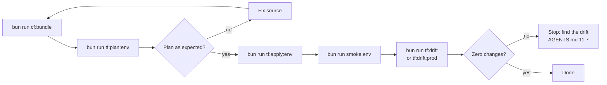

# Deployment Runbook

Operations guide for deploying Rhumbatron infrastructure and Worker bundles using Terraform.

## Principles

1. **Terraform-only control plane**: All remote Cloudflare resources, Workers, bindings, and configurations are managed exclusively by Terraform ([ADR 0004](../adr/0004-resource-organization-and-bootstrap-credentials.md), [ADR 0017](../adr/0017-prod-environment.md)). Never deploy using `wrangler deploy` or Cloudflare dashboard writes.
2. **Keychain credentials**: Credentials load from the macOS Keychain into environment variables via `scripts/tf.ts`. Secrets are never committed to Git or Terraform state files.
3. **No `-auto-approve`**: Always generate and inspect the saved plan file before applying. `scripts/tf.ts` refuses the flag.

`bun run tf <bootstrap|global|dev|prod> <terraform args...>` runs Terraform in one root with that root's Keychain credentials. The `tf:*` scripts wrap it.



---

## 1. Bundle Workers (`cf:bundle`)

Worker code must be bundled locally before planning or deploying:

```sh
bun run cf:bundle
```

- Compiles all deployables (`apps/web`, `workers/api`, `workers/coordinator`, `workers/agents`, `workers/event-router`, `workers/integration`, `workers/indexer`, `workers/sandbox`) via Turbo.
- Generates `dist/bundles/manifest.json` containing bundle file lists and SHA-256 hashes.
- Bundles are environment-neutral; environment configuration is supplied through Terraform bindings.

---

## 2. Deploy Environments

### Development (`dev`)

```sh
bun run cf:bundle
bun run tf:plan:dev     # writes dev.tfplan
bun run tf:apply:dev    # applies dev.tfplan
bun run tf:drift        # verifies clean plan for global and dev
```

### Production (`prod`)

```sh
bun run cf:bundle
bun run tf:plan:prod    # writes prod.tfplan
bun run tf:apply:prod   # applies prod.tfplan
bun run tf:drift:prod   # verifies clean plan for prod
```

### Global Singletons (`global`)

The `envs/global` root manages account-wide and zone-wide singletons: the DNS zone lookup, zone TLS settings (Strict SSL), and the account budget alerts at 10, 25, and 100 USD (ADR 0019). The `www` to apex redirect is in the prod web Worker, not in a zone rule.

```sh
bun run tf global plan -out=global.tfplan
bun run tf global apply global.tfplan
```

`bun run tf:drift` checks `global` and `dev` together.

---

## 3. Configuration Switches

Configured in `infrastructure/terraform/envs/dev/main.tf` and `infrastructure/terraform/envs/prod/main.tf`.

### `bootstrap` Switch

- **Location**: `locals { bootstrap = false }` in `envs/dev/main.tf` and `envs/prod/main.tf`.
- **Purpose**: Solves the circular dependency between `coordinator_worker` and `event_router_worker` ([ADR 0005](../adr/0005-durable-object-worker-deploys.md), [ADR 0017](../adr/0017-prod-environment.md)). In prod it also selects the first Durable Object migrations. Dev already runs v1, so its migrations are fixed at `v1 -> v1`.
- **First apply on fresh environment**:
  1. Set `bootstrap = true`.
  2. Plan and apply (`bun run tf:plan:<env>` && `bun run tf:apply:<env>`).
     - Omits the coordinator's `EVENT_ROUTER` service binding.
     - Prod: uploads the initial Durable Object migration (`new_tag = "v1"` with SQLite classes).
  3. Set `bootstrap = false`.
  4. Plan and apply again.
     - Adds the `EVENT_ROUTER` low-latency nudge binding to coordinator.
     - Prod: sets migration steady state to `old_tag = "v1", new_tag = "v1"`.

### `attach_apex` Switch

- **Location**: `locals { attach_apex = true }` in `envs/prod/main.tf`. The cutover is done: the value is `true` and the apex serves the prod web Worker.
- **Purpose**: Controls apex domain attachment (`rhumbatron.com` and `www.rhumbatron.com`) for the production web Worker ([ADR 0017](../adr/0017-prod-environment.md)).
- **Cutover sequence**:
  - Keep `attach_apex = false` during initial deployment. Cloudflare rejects Worker custom domain creation if an existing DNS record exists for the hostname.
  - Delete legacy DNS records at `rhumbatron.com`.
  - Set `attach_apex = true`, generate plan, and apply to attach the apex custom domain.

---

## 4. D1 Migrations Deploy Order

When a deployment includes new D1 migrations (`migrations/d1/*.sql`), Worker components (`api_worker`, `integration_worker`) depend on `terraform_data.d1_migrations` because updated worker code may query newly introduced tables or columns.

To prevent runtime errors during rollout, apply D1 migrations first:

```sh
# For dev:
bun run tf dev apply -target=terraform_data.d1_migrations

# For prod:
bun run tf prod apply -target=terraform_data.d1_migrations
```

After migrations succeed, proceed with the normal full plan and apply:

```sh
bun run tf:plan:dev && bun run tf:apply:dev
# or for prod:
bun run tf:plan:prod && bun run tf:apply:prod
```

---

## 5. Transient HTTP Errors

During Terraform operations, calls to the Cloudflare API can occasionally fail with transient network or gateway errors:

```text
Error: failed to make http request: ...
```

- **Cause**: Transient HTTP connection reset, Cloudflare edge timeout, or gateway blip.
- **Resolution**: Do not manually modify resources. Because Terraform persists completed resource states and Cloudflare resources are declarative, re-run the plan and apply command:

```sh
bun run tf:plan:dev && bun run tf:apply:dev
```
