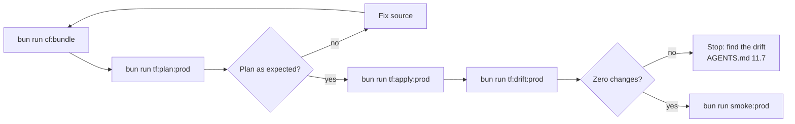

# Deployment Runbook

This runbook deploys Rhumbatron infrastructure and Worker bundles with Terraform.

## Rules

1. Terraform manages all remote Cloudflare resources, Workers, and bindings ([ADR 0004](../adr/0004-resource-organization-and-bootstrap-credentials.md), [ADR 0017](../adr/0017-prod-environment.md)). Do not deploy with `wrangler deploy` or with dashboard writes.
2. `scripts/tf.ts` loads credentials from the macOS Keychain into environment variables. Do not put secrets in Git or in Terraform source files.
3. Read the saved plan file before you apply it. `scripts/tf.ts` refuses `-auto-approve`.

`bun run tf <bootstrap|global|prod> <terraform args...>` runs Terraform in one root with the Keychain credentials of that root. The `tf:*` scripts in `package.json` call it.



## 1. Bundle the Workers

```sh
bun run cf:bundle
```

- `scripts/build-workers.ts` runs `turbo build` for `apps/*` and `workers/*`. Each Worker build is `wrangler deploy --dry-run --outdir dist` (local bundling only).
- It bundles `apps/web`, `apps/docs` (assets only), and `workers/api`, `coordinator`, `agents`, `event-router`, `integration`, `indexer`, `sandbox`, and `apps`.
- It writes `dist/bundles/manifest.json` with the module lists, the compatibility settings from each `wrangler.jsonc`, and one SHA-256 hash per bundle.
- Bundles are the same for every environment. Terraform bindings carry the environment configuration.

## 2. Deploy

Run the local checks first (`bun run check`). Every deploy goes to prod.

### Prod

```sh
bun run cf:bundle
bun run tf:plan:prod    # writes prod.tfplan
bun run tf:apply:prod   # applies prod.tfplan
bun run tf:drift:prod   # the plan must show zero changes
bun run smoke:prod
```

### Global

The `envs/global` root manages the account-wide and zone-wide singletons:

- The DNS zone lookup.
- The zone TLS settings: always HTTPS, automatic HTTPS rewrites, minimum TLS 1.2, TLS 1.3, and SSL `strict`.
- The account budget alerts at 10, 25, and 100 USD ([ADR 0019](../adr/0019-runaway-billing-guards.md)).

The prod web Worker redirects `www` to the apex (`apps/web/src/server.ts`). No zone rule does it.

```sh
bun run tf global plan -out=global.tfplan
bun run tf global apply global.tfplan
```

`bun run tf:drift` checks `global` and `prod` together.

## 3. Configuration switches

The switches are `locals` in `infrastructure/terraform/envs/prod/main.tf`. The pause switch is in [pause-resume.md](./pause-resume.md).

### `bootstrap`

- Value: `bootstrap = false`.
- Purpose: it breaks the binding cycle between `coordinator_worker` and `event_router_worker`, and it selects the first Durable Object migrations ([ADR 0005](../adr/0005-durable-object-worker-deploys.md)).
- First apply on a new account:
  1. Set `bootstrap = true`.
  2. Run `bun run tf:plan:prod`, then `bun run tf:apply:prod`. This apply leaves out the `EVENT_ROUTER` service binding of the coordinator. It uploads the first migrations (`new_tag = "v1"`, SQLite classes).
  3. Set `bootstrap = false`.
  4. Plan and apply again. This apply adds the `EVENT_ROUTER` binding. The migrations go to the steady state `old_tag = "v1"`, `new_tag = "v1"`.

### `attach_apex`

- Value: `attach_apex = true`.
- Purpose: it attaches `rhumbatron.com` and `www.rhumbatron.com` to the web Worker as custom domains ([ADR 0017](../adr/0017-prod-environment.md)).
- Rule: a Worker custom domain cannot take a hostname that has its own DNS record. Delete such a record before you set the switch to `true`.

### `apps.routing`

- Value: `apps.routing = true`.
- Purpose: it adds the proxied wildcard DNS record, the route `*.rhumbatron.com/*` to the apps Worker, and `APPS_DOMAIN` on the API ([ADR 0020](../adr/0020-live-apps-dynamic-workers.md)).
- Rule: a Workers route runs before a Worker custom domain on the same hostname. `apps.bypass_hosts` lists every custom-domain host (`api`, `www`, `docs`). Terraform adds a route without a Worker for each one. Add each new proxied subdomain to this list before it goes live.

## 4. D1 migration order

`terraform_data.d1_migrations` applies the files in `migrations/d1/*.sql` that are not applied yet. The api, integration, agents, and apps Workers depend on it, so Terraform applies the migrations before it deploys them. The event router and indexer Workers also use D1, but they do not depend on it.

When a deploy adds a migration, apply the migrations first:

```sh
bun run tf prod apply -target=terraform_data.d1_migrations
```

Then run the full plan and apply:

```sh
bun run tf:plan:prod
bun run tf:apply:prod
```

## 5. Transient HTTP errors

A Cloudflare API call can fail during a Terraform run with a connection reset, an edge timeout, or a gateway error:

```text
Error: failed to make http request: ...
```

Do not change resources by hand. Terraform keeps the state of the resources that completed. Run the plan and the apply again:

```sh
bun run tf:plan:prod
bun run tf:apply:prod
```
