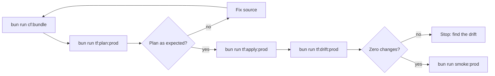

# Deployment Runbook

This runbook deploys Rhumbatron infrastructure and Worker bundles with Terraform.

## Rules

1. Terraform manages all remote Cloudflare resources, Workers, and bindings ([ADR 0004](../adr/0004-resource-organization-and-bootstrap-credentials.md), [ADR 0017](../adr/0017-prod-environment.md)). Do not deploy with `wrangler deploy` or with dashboard writes.
2. `scripts/tf.ts` loads credentials from the macOS Keychain into environment variables. Do not put secrets in Git or in Terraform source files.
3. Read the saved plan file before you apply it. `scripts/tf.ts` refuses `-auto-approve`.

`bun run tf <bootstrap|global|prod> <terraform args...>` runs Terraform in one root with the Keychain credentials of that root. The `tf:*` scripts in `package.json` use this command.



## 1. Bundle the Workers

```sh
bun run cf:bundle
```

- `scripts/build-workers.ts` runs `turbo build` for `apps/*` and `workers/*`. Each Worker build is `wrangler deploy --dry-run --outdir dist` (local bundling only).
- It bundles `apps/web`, `apps/docs` (assets only), and `workers/api`, `coordinator`, `agents`, `event-router`, `integration`, `indexer`, `sandbox`, and `apps`.
- It writes `dist/bundles/manifest.json` with the module lists, the compatibility settings from each `wrangler.jsonc`, and one SHA-256 hash per bundle.
- The bundles are the same for every environment. The Terraform bindings hold the environment configuration.

## 2. Deploy

Every deploy goes to prod. A push to `main` deploys automatically (see [Automatic deploy](#automatic-deploy)). The steps below do the same deploy from a developer machine. Run the local checks first (`bun run check`).

### Prod

```sh
bun run cf:bundle
bun run tf:plan:prod    # writes prod.tfplan
bun run tf:apply:prod   # applies prod.tfplan
bun run tf:drift:prod   # the plan must show zero changes
bun run smoke:prod
```

### Global

The `envs/global` root manages these account-wide and zone-wide singletons:

- The DNS zone lookup.
- The zone TLS settings: always HTTPS, automatic HTTPS rewrites, minimum TLS 1.2, TLS 1.3, and SSL `strict`.
- The account budget alerts at 10, 25, and 100 USD ([ADR 0019](../adr/0019-runaway-billing-guards.md)).

The prod web Worker redirects `www` to the apex (`apps/web/src/server.ts`). No zone rule does it.

```sh
bun run tf global plan -out=global.tfplan
bun run tf global apply global.tfplan
```

`bun run tf:drift` checks `global` and `prod` together.

## Automatic deploy

`.github/workflows/production.yml` runs on each push to `main` (ADR 0031):

1. It runs all checks from `ci.yml`.
2. It bundles the Workers and the docs site.
3. It writes `backend.hcl` from the account ID and runs `terraform init` for `envs/global` and `envs/prod`.
4. It plans both roots. `scripts/plan-guard.ts` stops the deploy when a plan deletes a D1 database, an R2 bucket, a KV namespace, a Queue, a Workflow, a Worker, a DNS record, a teardown adapter, or a Durable Object class.
5. It applies each root that has changes. The D1 migrations run inside the prod apply, before the Worker versions that need them.
6. It plans both roots again. Any change fails the deploy as drift.
7. It runs `bun run smoke:prod`.

Only one deploy runs at a time. A newer push waits, and replaces any deploy that is still in the queue.

The budget alerts adapter (`terraform_data.budget_alerts` in `envs/global`) needs the `cf` CLI login of an operator. CI does not apply a plan that changes it. The deploy shows a warning and continues with prod. Apply `envs/global` on an operator machine (`bun run tf global apply`). After a behavior change to `scripts/budget-alerts.ts`, add `-replace=terraform_data.budget_alerts`.

To apply a destructive plan on purpose, run the workflow manually from the Actions tab and select `allow_destructive`.

The deploy secrets are in the GitHub environment `production`. Only `main` can use that environment.

| Secret | Use |
|---|---|
| `CLOUDFLARE_API_TOKEN` | Terraform provider and the Terraform adapters |
| `CLOUDFLARE_ACCOUNT_ID` | `TF_VAR_account_id` and the R2 state endpoint |
| `R2_STATE_ACCESS_KEY_ID`, `R2_STATE_SECRET_ACCESS_KEY` | Terraform state in R2 |
| `CLERK_SECRET_KEY`, `CLERK_PUBLISHABLE_KEY` | Clerk production instance |
| `CLERK_SMOKE_USER_ID` | Signed-in smoke checks |
| `K2_CONSUMER_TOKEN` | K2 consumer for the event router |
| `ANTHROPIC_API_KEY`, `ANTHROPIC_WORKSPACE_ID` | Model calls through AI Gateway |
| `ALERT_EMAIL` | Account budget alerts (`envs/global`) |

### Migration rules

`bun run check:migrations` runs in CI. It enforces these rules:

- Migrations are append-only. Do not edit, rename, or delete a migration file.
- A new migration has the next number in `NNNN_description.sql`.
- The old Workers keep serving until the apply deploys the new versions. Every migration must therefore work with the code that runs before it. Add columns and tables first. Remove them in a later migration, after no code reads them.
- A migration with `DROP TABLE`, `DROP COLUMN`, or `RENAME` needs the line `-- destructive: reviewed`.

### When a deploy fails

- A failed check or a plan guard stops the deploy before Terraform changes anything.
- A failed apply leaves the resources that it already changed. Fix the cause and push again. Terraform continues from the current state.
- A failed smoke check leaves the new versions live. Push a fix, or revert the commit and push.

## 3. Configuration switches

The switches are `locals` in `infrastructure/terraform/envs/prod/main.tf`. [pause-resume.md](./pause-resume.md) describes the pause switch.

### `bootstrap`

- Value: `bootstrap = false`.
- Purpose: the switch breaks the binding cycle between `coordinator_worker` and `event_router_worker`. It also selects the first Durable Object migrations ([ADR 0005](../adr/0005-durable-object-worker-deploys.md)).
- First apply on a new account:
  1. Set `bootstrap = true`.
  2. Run `bun run tf:plan:prod`, then `bun run tf:apply:prod`. This apply leaves out the `EVENT_ROUTER` service binding of the coordinator. It uploads the first migrations (`new_tag = "v1"`, SQLite classes).
  3. Set `bootstrap = false`.
  4. Plan and apply again. This apply adds the `EVENT_ROUTER` binding. The migrations go to the steady state `old_tag = "v1"`, `new_tag = "v1"`.

### `attach_apex`

- Value: `attach_apex = true`.
- Purpose: the switch attaches `rhumbatron.com` and `www.rhumbatron.com` to the web Worker as custom domains ([ADR 0017](../adr/0017-prod-environment.md)).
- Rule: a Worker custom domain cannot take a hostname that has its own DNS record. Delete such a record before you set the switch to `true`.

### `apps.routing`

- Value: `apps.routing = true`.
- Purpose: the switch adds the proxied wildcard DNS record, the route `*.rhumbatron.com/*` to the apps Worker, and `APPS_DOMAIN` on the API ([ADR 0020](../adr/0020-live-apps-dynamic-workers.md)).
- Rule: a Workers route runs before a Worker custom domain on the same hostname. `apps.bypass_hosts` lists every custom-domain host (`api`, `www`, `docs`). Terraform adds a route without a Worker for each host. Add each new proxied subdomain to this list before you make it live.

## 4. D1 migration order

`terraform_data.d1_migrations` applies the pending files in `migrations/d1/*.sql`. The api, integration, agents, and apps Workers depend on this resource. Terraform therefore applies the migrations before it deploys these Workers. The event router and indexer Workers also use D1, but they do not depend on the resource.

When a deploy adds a migration, apply the migrations first.

```sh
bun run tf prod apply -target=terraform_data.d1_migrations
```

Then run the full plan and apply.

```sh
bun run tf:plan:prod
bun run tf:apply:prod
```

## 5. Transient HTTP errors

A Cloudflare API call can fail during a Terraform run with a connection reset, an edge timeout, or a gateway error. The error looks like this:

```text
Error: failed to make http request: ...
```

Do not change resources by hand. Terraform keeps the state of the resources that completed. Run the plan and the apply again.

```sh
bun run tf:plan:prod
bun run tf:apply:prod
```
