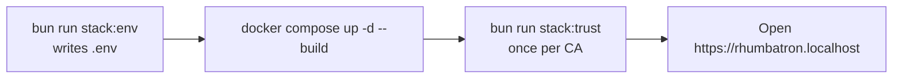

# Local Stack Runbook

This runbook starts, stops, and configures the Rhumbatron stack. The stack is one Docker Compose project (`compose.yaml`) behind Caddy at `https://rhumbatron.localhost`. [ADR 0034](../adr/0034-docker-compose-stack.md) gives the reasons for each component.

## 1. Prerequisites

| Tool | Use |
|---|---|
| [Docker Desktop](https://www.docker.com/products/docker-desktop/) (or Docker Engine with Compose on Linux) | Builds and runs the services. |
| [Bun](https://bun.sh) 1.3.14 | Runs `scripts/local-env.ts`, `scripts/trust-local-ca.ts`, and the checks. |
| Clerk development keys | Sign-in. Put them in `apps/web/.env.local` (copy `apps/web/.env.example`). |
| An Anthropic API key | Model calls. Put it in the macOS Keychain item `rhumbatron-anthropic-api-key`, or set `ANTHROPIC_API_KEY` in the shell. |

## 2. Start the stack

```sh
bun install
bun run stack:up
```

`bun run stack:up` does two steps:

1. `bun scripts/local-env.ts` writes `.env` (see [section 5](#5-settings)).
2. `docker compose up -d --build` builds the images and starts every service.

The first start takes longer. Docker builds all images. The `embed` and `rerank` services download their models (about 300 MB) from Hugging Face into the `models` volume.



## 3. Trust the local certificate authority

```sh
bun run stack:trust
```

Caddy (the `edge` service) creates its own certificate authority on its first start. It signs the certificates for `rhumbatron.localhost` and every subdomain. A browser does not accept these certificates until the system trusts the CA.

`scripts/trust-local-ca.ts` copies the root certificate out of the `edge` container to `.local-ca.crt`. On macOS, it adds the certificate to the System keychain. This step asks for your password once. Restart the browser if it was open. On Linux, the script prints the commands that add the certificate to the system trust store.

Run the command again after `docker compose down -v`, because a new `caddy-data` volume holds a new CA.

Bun and Node scripts do not read the System keychain. Give them the certificate file:

```sh
NODE_EXTRA_CA_CERTS=.local-ca.crt bun run smoke local
```

## 4. Hostnames and logs

| Host | Service |
|---|---|
| `https://rhumbatron.localhost` | `web`. Caddy sends `/live/*` to `core`. |
| `https://api.rhumbatron.localhost` | `core` (the API). |
| `https://docs.rhumbatron.localhost` | The docs site. The `edge` image builds it from `docs/`. |
| `https://<slug>.rhumbatron.localhost` | `apps`: the live app of a Project. |
| `https://<previewId>--<slug>.rhumbatron.localhost` | `apps`: a Candidate preview or a kept version. |

Browsers resolve every `*.localhost` name to the loopback address, so the stack needs no DNS record.

Logs:

```sh
bun run stack:logs              # every service, follow, last 100 lines
docker compose logs -f core     # one service
docker compose ps               # service state and health
```

Core writes one JSON line per event (`packages/platform/src/log.ts`). Docker keeps the logs.

## 5. Settings

Compose reads its settings from `.env` in the repository root. Git ignores the file. `bun run stack:env` (also the first step of `stack:up`) writes it with `scripts/local-env.ts`:

- It keeps every value that `.env` already has. A second run changes nothing.
- It reads the Clerk development keys from `apps/web/.env.local` (`VITE_CLERK_PUBLISHABLE_KEY`, `CLERK_SECRET_KEY`). A shell variable of the same name wins. The secret key can also come from the Keychain item `rhumbatron-clerk-secret-key-dev`.
- It reads `ANTHROPIC_API_KEY` from the shell, or from the Keychain item `rhumbatron-anthropic-api-key`. It reads `ANTHROPIC_WORKSPACE_ID` the same way (Keychain item `rhumbatron-anthropic-workspace-id`).
- It generates random values for `INTERNAL_TOKEN`, `GIT_ADMIN_TOKEN`, `GIT_TOKEN_SECRET`, `SANDBOXD_TOKEN`, `S3_ACCESS_KEY`, and `S3_SECRET_KEY`.
- It never prints a secret. It names each value that it could not find.

To change a setting, edit `.env` and run `docker compose up -d`. These optional settings have defaults in `compose.yaml`:

| Variable | Default | Meaning |
|---|---|---|
| `ANTHROPIC_MONTHLY_BUDGET_USD` | `100` | Monthly cap on Anthropic spend ([costs.md](./costs.md)). |
| `ALLOW_OPUS` | `false` | `true` lets the opus tier call Opus. Otherwise it runs on Sonnet. |
| `PLATFORM_ADMIN_USER_IDS` | `[]` | JSON array of Clerk user IDs that are platform admins ([ADR 0033](../adr/0033-platform-admin-and-access.md)). |
| `SANDBOX_RUNTIME` | `runc` | Container runtime of each Sandbox. |
| `SANDBOX_MAX` | `4` | Live Sandboxes at one time. |
| `SANDBOX_IDLE_MS` | `120000` | Idle time before sandboxd removes a Sandbox and its disk. |
| `SANDBOX_CPUS`, `SANDBOX_MEMORY_MB` | `2`, `2048` | CPUs and memory of each Sandbox. |
| `DOCKER_GID` | `0` | Group of the Docker socket for the socket proxy. |

Core reads `SANDBOX_MONTHLY_SECONDS` and `BROWSER_DAILY_SECONDS` from its environment (`services/core/src/config.ts`). `compose.yaml` does not set them, so core uses its defaults: 72,000 seconds per month and 960 seconds per day.

## 6. Stop the stack and keep or delete data

```sh
bun run stack:down          # docker compose down: stops the stack, keeps the data
docker compose down -v      # stops the stack and deletes every data volume
```

`bun run stack:down` is the pause. Nothing runs and nothing bills while the stack is down. `bun run stack:up` starts it again with the same data.

| Volume | Service | Content |
|---|---|---|
| `core-data` | `core` | `rhumbatron.sqlite` (product database, key-value, vectors, metrics), `workflows.sqlite`, and `actors/` (one SQLite file per actor). |
| `git-data` | `git` | One bare repository per Project, Task fork, and Candidate fork, and `_meta/git.sqlite`. |
| `objects-data` | `objects` | The `rhumbatron-evidence` bucket: Evidence, context packets, app bundles, and the event archive. |
| `nats-data` | `nats` | The JetStream command and event streams. |
| `apps-data` | `apps` | The data of each live app and preview. |
| `caddy-data`, `caddy-config` | `edge` | The local CA, the certificates, and the Caddy state. |
| `models` | `embed`, `rerank` | The downloaded model files. |

Core applies pending migrations from `migrations/d1` at each start. It records each applied file in the `d1_migrations` table and runs each file in one transaction.

## 7. Checks against the stack

The checks run on your computer and call the stack over HTTPS. Set `CLERK_SECRET_KEY` and `CLERK_SMOKE_USER_ID` (a user of the Clerk development instance) for the signed-in checks.

| Command | What it checks |
|---|---|
| `bun run smoke local` | Health, version, and the signed-in Project and Change flow. `--plan` also plans a real goal. `--sandbox` also runs a Sandbox check and two promotions. |
| `bun run e2e local` | Every public API route: status codes, error codes, and response shapes. It makes no model call. |
| `bun run journeys local [A1,A2,...\|all]` | Whole requests with real planning, agents, Sandbox checks, promotion, and live app releases. It spends model budget. |

Each command archives the Projects that it creates.

## 8. Run on a Linux server

The same `compose.yaml` runs on one Linux server with Docker Engine and the Compose plugin. Set two values in `.env`:

| Variable | Value | Reason |
|---|---|---|
| `SANDBOX_RUNTIME` | `runsc` | Runs each Sandbox under gVisor. Install gVisor and register `runsc` as a Docker runtime first. |
| `DOCKER_GID` | The group ID of `docker`, for example the output of `getent group docker \| cut -d: -f3` | The socket proxy runs as user `65534` in this group, so it can read `/var/run/docker.sock`. Docker Desktop uses group `0`. |

Then run `bun run stack:up` and `bun run stack:trust` on the server.

## 9. Continuous integration

`.github/workflows/ci.yml` runs the repository checks on each pull request. No workflow deploys. The stack runs only where an operator starts it.
