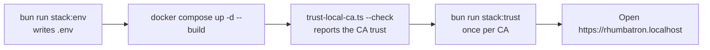

# Local Stack Runbook

This runbook tells you how to start, stop, and configure the Rhumbatron stack. The stack is one Docker Compose project (`compose.yaml`). Caddy serves it at `https://rhumbatron.localhost`. [ADR 0034](../adr/0034-docker-compose-stack.md) gives the reason for each component.

## 1. Prerequisites

| Tool | Use |
|---|---|
| [Docker Desktop](https://www.docker.com/products/docker-desktop/), or Docker Engine with the Compose plugin on Linux | Builds and runs the services. |
| [Bun](https://bun.sh) 1.3.14 | Runs `scripts/local-env.ts`, `scripts/trust-local-ca.ts`, and the checks. |
| Clerk development keys | Sign-in. Put them in `apps/web/.env.local`. Copy `apps/web/.env.example` to start. |
| An Anthropic API key | Model calls. Put it in the macOS Keychain item `rhumbatron-anthropic-api-key`, or set `ANTHROPIC_API_KEY` in the shell. |

## 2. Start the stack

```sh
bun install
bun run stack:up
```

`bun run stack:up` does three steps:

1. `bun scripts/local-env.ts` writes `.env` (see [section 5](#5-settings)).
2. `docker compose up -d --build` builds the images and starts every service.
3. `bun scripts/trust-local-ca.ts --check` reports whether your computer trusts the local CA.

The first start takes more time. Docker builds all images. The `embed` and `rerank` services download their models from Hugging Face into the `models` volume. The models are about 300 MB.



## 3. Trust the local certificate authority

Caddy (the `edge` service) makes its own certificate authority (CA) at its first start. The CA lives in the `caddy-data` volume. Caddy signs the certificate of every `*.rhumbatron.localhost` host with this CA. A browser accepts these certificates only when the computer trusts the CA.

Do this procedure once:

1. Start the stack with `bun run stack:up`.
2. Run `bun run stack:trust`.
3. On macOS, type your password when macOS asks for it.
4. Restart the browser if it is open.

`scripts/trust-local-ca.ts` does these steps:

- It copies the root certificate from the `edge` container to `.local-ca.crt` in the repository root.
- On macOS, it adds the certificate to your login keychain as a trusted root. It uses no `sudo`.
- It does nothing more when the computer trusts the CA already.
- After it adds the certificate, it verifies the trust. It stops with an error when macOS does not accept the trust setting.
- On Linux, it prints the commands that add the certificate to the system trust store.

Run `bun run stack:trust` again after `docker compose down -v`. That command deletes the `caddy-data` volume, and the next start makes a different CA.

Firefox reads the macOS keychain only when its setting `security.enterprise_roots.enabled` is `true`. Set it on the `about:config` page.

Bun and Node scripts do not read the keychain. Give them the certificate file:

```sh
NODE_EXTRA_CA_CERTS=.local-ca.crt bun run smoke local
```

## 4. Hostnames and logs

| Host | Service |
|---|---|
| `https://rhumbatron.localhost` | `web`. Caddy sends `/live/*` to `core`. |
| `https://api.rhumbatron.localhost` | `core` (the API). |
| `https://docs.rhumbatron.localhost` | The docs site. The `edge` image builds it from `docs/`. The public copy is at `https://rhumbatron.com` ([Docs site](#11-docs-site)). |
| `https://<slug>.rhumbatron.localhost` | `apps`: the live app of a Project. |
| `https://<previewId>--<slug>.rhumbatron.localhost` | `apps`: a Candidate preview or a kept version. |

Browsers resolve every `*.localhost` name to the loopback address. The stack needs no DNS record.

Logs:

```sh
bun run stack:logs              # every service, follow, last 100 lines
docker compose logs -f core     # one service
docker compose ps               # service state and health
```

Core writes one JSON line per log event (`packages/platform/src/log.ts`). Docker keeps the logs.

## 5. Settings

Compose reads its settings from `.env` in the repository root. Git ignores this file. `bun run stack:env` writes it with `scripts/local-env.ts`. `bun run stack:up` runs the same script first.

- The script keeps every value that `.env` has. A second run changes nothing.
- It reads the Clerk development keys from `apps/web/.env.local` (`VITE_CLERK_PUBLISHABLE_KEY`, `CLERK_SECRET_KEY`). A shell variable with the same name has priority. The secret key can also come from the Keychain item `rhumbatron-clerk-secret-key-dev`.
- It reads `ANTHROPIC_API_KEY` from the shell or from the Keychain item `rhumbatron-anthropic-api-key`.
- It reads `ANTHROPIC_WORKSPACE_ID` from the shell or from the Keychain item `rhumbatron-anthropic-workspace-id`.
- It makes random values for `INTERNAL_TOKEN`, `GIT_ADMIN_TOKEN`, `GIT_TOKEN_SECRET`, `SANDBOXD_TOKEN`, `S3_ACCESS_KEY`, and `S3_SECRET_KEY`.
- It never prints a secret. It names each value that it cannot find.

To change a setting, edit `.env` and run `docker compose up -d`. `compose.yaml` gives these optional settings a default:

| Variable | Default | Meaning |
|---|---|---|
| `ANTHROPIC_MONTHLY_BUDGET_USD` | `100` | Monthly cap on Anthropic spend ([costs.md](./costs.md)). |
| `ANTHROPIC_WORKSPACE_ID` | empty | Anthropic workspace ID. Model calls send it in the `anthropic-workspace-id` header when it is set. |
| `ALLOW_OPUS` | `false` | `true` lets the opus tier call Opus. With `false`, the opus tier runs on Sonnet. |
| `PLATFORM_ADMIN_USER_IDS` | `[]` | JSON array of the Clerk user IDs of the platform admins ([ADR 0033](../adr/0033-platform-admin-and-access.md)). |
| `SANDBOX_MONTHLY_SECONDS` | `72000` | Awake Sandbox time per UTC month (20 hours). |
| `BROWSER_DAILY_SECONDS` | `3600` | Browser check time per UTC day. |
| `SANDBOX_RUNTIME` | `runc` | Container runtime of each Sandbox. |
| `SANDBOX_MAX` | `4` | Live Sandboxes at one time. |
| `SANDBOX_IDLE_MS` | `120000` | Idle time before sandboxd removes a Sandbox and its disk. |
| `SANDBOX_CPUS`, `SANDBOX_MEMORY_MB` | `2`, `2048` | CPUs and memory of each Sandbox. |
| `DOCKER_GID` | `0` | Group of the Docker socket for the socket proxy. |

Core reads its settings once, at start (`services/core/src/config.ts`). `services/core/src/config.ts` has the same defaults as `compose.yaml`.

## 6. Stop the stack and keep or delete data

```sh
bun run stack:down          # docker compose down: stops the stack, keeps the data
docker compose down -v      # stops the stack and deletes every data volume
```

`bun run stack:down` pauses the stack. Nothing runs and nothing bills while the stack is down. `bun run stack:up` starts it again with the same data.

| Volume | Service | Content |
|---|---|---|
| `core-data` | `core` | `rhumbatron.sqlite` (product database, key-value, vectors, metrics), `workflows.sqlite`, and `actors/` (`registry.sqlite` and one SQLite file per actor). |
| `git-data` | `git` | One bare repository per Project, Task fork, and Candidate fork, and `_meta/git.sqlite`. |
| `objects-data` | `objects` | The `rhumbatron-evidence` bucket: Evidence, Context Packets, app bundles, and the event archive. |
| `nats-data` | `nats` | The JetStream command and event streams. |
| `apps-data` | `apps` | The data of each live app and preview. |
| `caddy-data`, `caddy-config` | `edge` | The local CA, the certificates, and the Caddy state. |
| `models` | `embed`, `rerank` | The model files. |

Core applies the pending SQL files of `migrations/d1` at each start. It records each applied file in the `d1_migrations` table. It runs each file in one transaction.

## 7. Restarts

- Every long-running service has `restart: unless-stopped`.
- `core` has the fixed address `172.31.240.10` on the `default` network (subnet `172.31.240.0/24`).
- workerd in `apps` resolves the name `core` once, at start. The fixed address keeps this result correct after `core` restarts.
- `apps` has `depends_on: core { condition: service_healthy, restart: true }`. Compose restarts `apps` when it restarts `core`.

## 8. Checks against the stack

The checks run on your computer and call the stack over HTTPS. Set `NODE_EXTRA_CA_CERTS=.local-ca.crt`. For the signed-in checks, also set `CLERK_SECRET_KEY` and `CLERK_SMOKE_USER_ID`. `CLERK_SMOKE_USER_ID` is a user of the Clerk development instance.

| Command | What it checks |
|---|---|
| `bun run smoke local` | Health, version, and the signed-in Project and Change flow. `--plan` also plans a real goal. `--sandbox` also runs a Sandbox check and two promotions. |
| `bun run e2e local` | Every public API route: status codes, error codes, and response shapes. It makes no model call. |
| `bun run journeys local A1,A2` | Whole requests with real planning, agents, Sandbox checks, promotion, and live app releases. Give journey IDs, or `all`. It spends model budget. |
| `bun run test:ui` | The Playwright UI suite in `e2e/ui` on `https://rhumbatron.localhost`. `e2e/ui/build-app.spec.ts` makes a blank Project, sends one instruction, and waits for a working live app. |

`playwright.config.ts` sets `ignoreHTTPSErrors`, so the UI suite also runs before you trust the CA.

The smoke, e2e, and journey runs delete or archive each Project that they make. `e2e/ui/build-app.spec.ts` keeps its Project.

## 9. Run on a Linux server

The same `compose.yaml` runs on one Linux server with Docker Engine and the Compose plugin. Set two values in `.env`:

| Variable | Value | Reason |
|---|---|---|
| `SANDBOX_RUNTIME` | `runsc` | Runs each Sandbox under gVisor. Install gVisor and register `runsc` as a Docker runtime first. |
| `DOCKER_GID` | The group ID of `docker`, for example the output of `getent group docker \| cut -d: -f3` | The socket proxy runs as user `65534` in this group, so it can read `/var/run/docker.sock`. Docker Desktop uses group `0`. |

Then run `bun run stack:up` and `bun run stack:trust` on the server.

## 10. Continuous integration

`.github/workflows/ci.yml` runs the repository checks on each pull request and on each push to `main`. It uses no secrets. It deploys nothing. The stack runs only where an operator starts it. The `docs` workflow publishes only the docs site ([Docs site](#11-docs-site)).

## 11. Docs site

The public docs site is at `https://rhumbatron.com`. It is a Cloudflare Worker with static assets only, named `rhumbatron-docs`. Requests for static assets are free. `apps/docs/wrangler.json` holds the Worker configuration.

| Host | Behavior |
|---|---|
| `https://rhumbatron.com` | The docs site. Unknown paths get the `404.html` page of the site. |
| `https://www.rhumbatron.com` | The zone redirect rule `www_to_apex` sends a `301` to `https://rhumbatron.com` with the same path and query. |

### Publish

The `docs` workflow (`.github/workflows/docs.yml`) publishes the site after each push to `main` that changes `docs/`, `README.md`, or `apps/docs/`. It builds `apps/docs` with `DOCS_SITE=https://rhumbatron.com`, runs `wrangler deploy`, and makes sure that both hosts answer. It runs only when the repository variable `CLOUDFLARE_ACCOUNT_ID` exists. To start it by hand:

```sh
gh workflow run docs.yml
```

To publish from this computer without a push:

```sh
bun run docs:deploy
```

`scripts/deploy-docs.ts` builds the site, copies it to a deploy folder in the system temporary folder with the configuration from `apps/docs/wrangler.json`, and runs `cf deploy` there. The `cf` CLI must be logged in to the Cloudflare account.

### One-time setup

```sh
bun scripts/setup-docs-publishing.ts
```

The script needs the `cf` CLI and the `gh` CLI, both logged in. Each step checks first, so a second run changes nothing.

1. It creates the proxied DNS record `www.rhumbatron.com` and the redirect rule `www_to_apex`.
2. It creates a Cloudflare API token that can deploy Workers on the account and change Worker routes and DNS on `rhumbatron.com` only. It sends the token through a pipe to the GitHub secret `CLOUDFLARE_API_TOKEN`. It does not print the token.
3. It sets the GitHub variable `CLOUDFLARE_ACCOUNT_ID`, which turns on the `docs` workflow.
4. It starts the `docs` workflow once.

The docs site is the only part of Rhumbatron on Cloudflare.
