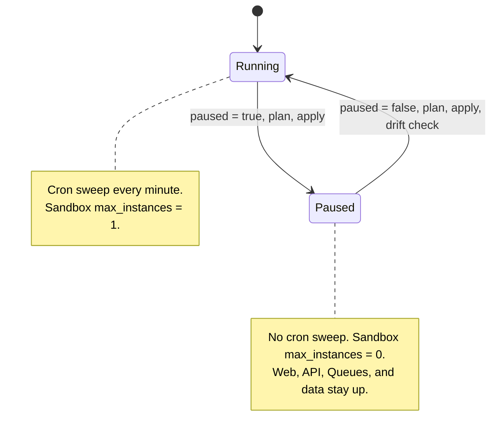

# Pause and Resume Runbook

This runbook pauses and resumes autonomous background work: cron sweeps and Sandbox containers.

## Purpose

The `paused` switch stops autonomous background compute and container execution at once. It prevents runaway compute cost and exhausted limits. It does not destroy infrastructure or delete data (`AGENTS.md` rule 50, [ADR 0017](../adr/0017-prod-environment.md)).

---

## 1. The `paused` Switch

The prod Terraform root declares the pause setting:

- Prod: `infrastructure/terraform/envs/prod/main.tf` (`locals { paused = false }`)



---

## 2. What `paused = true` Stops

1. **Event Router Cron Sweep**:
   - `module.event_router_worker`:
     ```hcl
     cron_schedules = local.paused ? [] : ["* * * * *"]
     ```
   - The pause removes the 1-minute safety-net cron trigger that sweeps the K2 event streams.
2. **Sandbox Containers**:
   - `local.sandbox_worker`:
     ```hcl
     max_instances = local.paused ? 0 : 1
     ```
   - The pause sets the maximum container instances to 0 ([ADR 0012](../adr/0012-sandbox-worker.md)).
   - No new container can start, so Sandbox runtime stops growing.

---

## 3. What Keeps Running

The pause keeps all resources, and the application stays online.

- **Data plane**: D1 databases, Durable Object SQLite storage, R2 evidence buckets, KV namespaces, K2 event logs, and Cloudflare Artifacts repositories stay intact.
- **Web and API ingress**: The web frontend (`rhumbatron.com`) and the API Worker (`api.rhumbatron.com`) continue to serve HTTP traffic.
- **Queues and direct triggers**: Queue consumers and the low-latency coordinator publish nudges stay bound. Consumers can process existing messages, or the messages stay in the queues.
- **Durable Object alarms**: The pause does not stop them. The alarm guards of [ADR 0019](../adr/0019-runaway-billing-guards.md) bound them (at most 2,000 fires per object per UTC day).

---

## 4. How to Pause

1. Edit `locals` in `infrastructure/terraform/envs/prod/main.tf`:
   ```hcl
   locals {
     paused = true
     # ...
   }
   ```
2. If Worker code changed, run `bun run cf:bundle`.
3. Run the plan. Before you apply, make sure that `cron_schedules` is empty and `max_instances` is 0.
   ```sh
   bun run tf:plan:prod
   bun run tf:apply:prod
   ```

---

## 5. How to Resume

1. Edit `locals` in `infrastructure/terraform/envs/prod/main.tf`:
   ```hcl
   locals {
     paused = false
     # ...
   }
   ```
2. Run the plan, and then apply it:
   ```sh
   bun run tf:plan:prod
   bun run tf:apply:prod
   ```
3. Run the drift check:
   ```sh
   bun run tf:drift:prod
   ```
