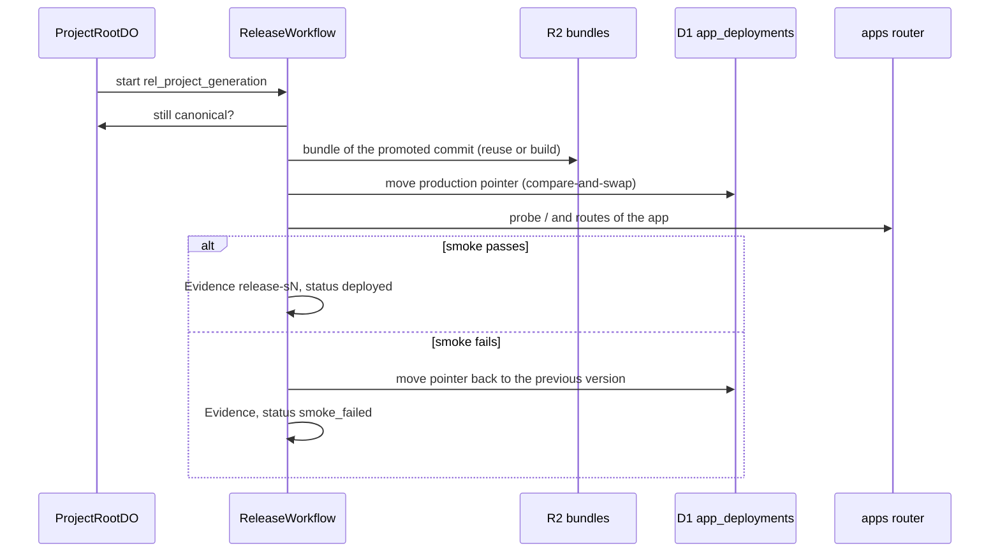

# Application Releases Runbook

This runbook covers how a promoted Candidate becomes a live app, and how to check a release.

## Principles

Promotion moves the Canonical Generation. A release then serves the promoted commit. `ReleaseWorkflow` verifies each release with executable Evidence (`AGENTS.md` sections 21.3 and 37). No model decides whether a release is authorized.

A release never deletes history. A failed release leaves the Canonical Generation in place. To recover, promote a new generation (a fix Change, or a rollback, which is a new canonical transition).

---

## 1. Live App Release (prod)

Every prod Project has a live app at `<slug>.rhumbatron.com`. The apps Worker (`rhumbatron-apps-prod`) serves it through Dynamic Workers. A deploy is runtime data: an R2 bundle plus a D1 pointer (`app_deployments`). Terraform does not change per deploy.



1. **Start**: Promotion fast-forwards canonical `main` in the Project's Artifacts repository. It then starts `ReleaseWorkflow` with instance ID `rel_<project>_<generation>`.
2. **Bundle**: The workflow uses the stored bundle of the promoted commit. A bundle can come from the same tree, from the Candidate preview, or from a new build. A new build reads the source from Artifacts and runs on the apps Worker. The cap is 60 builds per day (`APP_BUILDS_PER_DAY`).
3. **Pointer**: The workflow moves the production pointer by compare-and-swap on the row that it read. The previous version stays.
4. **Smoke check**: The workflow probes the app through the apps router. It probes `/` (a real page, not a router status page) and up to a bounded number of static `GET` routes from the app's route table. It retries one failed attempt once after a pause.
5. **Evidence**: The workflow stores release Evidence under check ID `release-s<generation>` in R2 and in D1 `evidence_index`.
6. **Status**: A passed smoke check sets the release to `deployed`. A failed smoke check moves the pointer back to the version it replaced and sets `smoke_failed`. A newer promotion during the release sets `superseded`.

### Hosts

| Host | Serves |
|---|---|
| `<slug>.rhumbatron.com` | The production version. |
| `<previewId>--<slug>.rhumbatron.com` | The preview of one Candidate. Preview bundles expire after 7 days (R2 lifecycle rule on `app-previews/`). A Change keeps at most 3 previews. |
| `v0000001--<slug>.rhumbatron.com` | One kept version. The number is the Canonical Generation, padded to 7 digits. |

A Project with no shipped Change shows "Nothing built yet". After "Remove app", the host answers 410.

### Rollback

A rollback to generation Sk is a new canonical transition Sn to Sn+1. The new tree equals the tree of Sk. It takes the same path as every promotion, including the approval policy and the release.

### Stuck releases

A Change that stays `releasing` for 45 minutes is failed by the `release.recover` command. The event router queues it every 5 minutes. While `locals.paused = true`, the cron does not run, so this recovery waits for the resume ([pause-resume.md](./pause-resume.md)).

---

## 2. Release Target Worker (Workers Builds)

A Project releases through Workers Builds only when D1 `release_targets` holds a row for it. The code and the Terraform Worker shell `rhumbatron-acme-shop-prod` (`cloudflare_worker.acme_shop`) exist. No migration and no code inserts a row for a prod Project, so no prod Project uses this path.

A Project with a live app always takes the live app path.

For a release target, the workflow polls the Workers Builds API for the build of the promoted commit and reads the Worker deployment. It uses the secret `BUILDS_API_TOKEN` on the integration Worker. Terraform loads it from the sensitive variable `builds_api_token` (Keychain item `rhumbatron-cloudflare-builds-token`). The token needs `Workers Builds Configuration Edit` and `Workers Scripts Read`. The Worker sends read-only `GET` requests.

The Builds API rejects `cloudflare_artifacts` request bodies, so the connection of an Artifacts repository to the Worker is a one-time dashboard action under Worker, Settings, Builds.

---

## 3. Checking a Release

For a live app, read the release panel on the Candidate page. It shows the status, the version, and the smoke Evidence. `bun run e2e prod` also checks the app routes, versions, code reads, rollback refusals and "Remove app" on a new empty Project.

`bun run smoke:release` checks a Project that has a release target:

```sh
bun run smoke:release                       # Project with slug acme-shop-live
bun run smoke:release prod --project <project-id>
```

- **Credentials**: Set `CLERK_SECRET_KEY` and `CLERK_SMOKE_USER_ID`. Without them, the script reads the Keychain items `rhumbatron-clerk-secret-key-prod` and `rhumbatron-clerk-smoke-user-id-prod`.
- **Checks**: The release target exists. The latest release that is not superseded is `deployed`. A version and smoke Evidence are recorded. The release URL answers the probes.
- A Project without a release target fails the first check.
