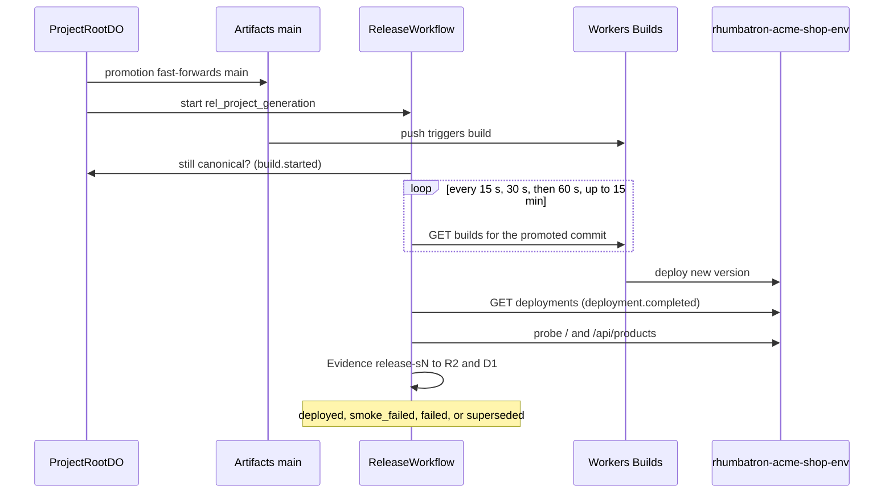

# Application Releases Runbook

This runbook covers application releases through Cloudflare Workers Builds, release smoke checks, and failure injection.

## Principles

A Git push to Cloudflare Artifacts starts each application release. `ReleaseWorkflow` then verifies the release with executable Evidence (`AGENTS.md` sections 21.3 and 37, [ADR 0018](../adr/0018-release-via-workers-builds.md)).

**Status (2026-10-10): connected.** The Workers Builds connection from the Artifacts repo `rhumbatron-projects-dev/proj_077b581d-15b3-4f6d-b68a-6a6659cc2668` (Acme Shop Live) to `rhumbatron-acme-shop-dev` exists. An operator made it in the dashboard (Worker → Settings → Builds → Connect), because the Builds API rejects `cloudflare_artifacts` request bodies (error 12065).

| Item | Value |
|---|---|
| Trigger UUID | `4fb2e3cf-ac43-4cd3-8107-855a94059a7b` |
| Repo connection UUID | `c61776d4-d809-44aa-8915-a68f29982ce4` (provider `cloudflare_artifacts`) |
| Branch | `main` only; Preview builds are off |
| Build command | none |
| Deploy command | `npx wrangler@4.149.0 deploy` |
| Build token | `rhumbatron acme-shop-dev build token` (created by the dashboard, dedicated to this Worker) |

Check it with `cf builds triggers list --external-script-id <worker tag>`.

---

## 1. How Releases Work ([ADR 0018](../adr/0018-release-via-workers-builds.md))

### Architecture



1. **Promotion trigger**:
   - When a Candidate is accepted, promotion fast-forwards the canonical `main` branch in the Project's Cloudflare Artifacts repository.
   - Promotion then starts `ReleaseWorkflow` with instance ID `rel_<project>_<generation>`.
   - **No direct deploy API calls**: Rhumbatron never calls a Workers Builds write API at runtime. The push to `main` starts Workers Builds directly.
2. **Workers Builds run**:
   - Terraform manages the release target Worker shell (`cloudflare_worker.acme_shop`, `rhumbatron-acme-shop-<env>`).
   - Workers Builds owns the Worker's versions and deployments as runtime data, so Terraform shows no drift.
3. **Workflow observation steps** (`ReleaseWorkflow` on the integration Worker):
   - **Verify canonical**: The workflow confirms that the generation is still canonical in `ProjectRootDO`. It sets the state to `building` (`build.started`).
   - **Poll builds**: The workflow polls `GET /builds/workers/{tag}/builds` with backoff (15 s, 30 s, 60 s; up to 15 minutes). It checks that the build trigger commit matches the promoted commit SHA.
   - **Confirm deployment**: The workflow reads the active script deployment version through `GET /workers/scripts/{name}/deployments`. It emits `deployment.completed`.
   - **Probe release URL**: The workflow probes `/` (200), `/api/products` (200 JSON), and up to two contract routes that the Change added.
   - **Save Evidence**: The workflow stores release Evidence in R2 and in D1 `evidence_index` under check ID `release-s<generation>`.
   - **Status transition**: On success, the release goes to `deployed`. On probe failure, it goes to `smoke_failed` or `failed`.
4. **Superseding**:
   - A new generation can be promoted while an older release is `queued` or `building`. The workflow then marks the older release `superseded`.
5. **Forward-only recovery**:
   - A failed release never rolls back the Canonical Generation and never deletes history.
   - To recover, promote a new generation (a fix or revert Change).

---

## 2. One-Time Workers Builds Setup

Connect the Project's Artifacts repository to Workers Builds once per release Worker ([ADR 0014](../adr/0014-workers-builds-artifacts-connection.md), [ADR 0018](../adr/0018-release-via-workers-builds.md)).

### Option A: `cf` CLI Connection ([ADR 0018](../adr/0018-release-via-workers-builds.md))

```sh
cf builds workers create \
  --worker rhumbatron-acme-shop-<env> \
  --repo-namespace rhumbatron-projects-<env> \
  --repo <project-id> \
  --branch main \
  --deploy-command "npx wrangler@4.149.0 deploy"
```

### Option B: Cloudflare Dashboard ([ADR 0014](../adr/0014-workers-builds-artifacts-connection.md))

1. Go to Worker `rhumbatron-acme-shop-<env>` → **Settings** → **Builds**.
2. Click **Connect**.
3. Choose the Artifacts namespace `rhumbatron-projects-<env>`.
4. Select the Project repository.
5. Set the production branch to `main`.
6. Set the deploy command to `npx wrangler@4.149.0 deploy`.
7. Authorize with a dedicated build token.

### Runtime Token

`ReleaseWorkflow` observes builds with the sensitive Terraform variable `builds_api_token` (`rhumbatron-cloudflare-builds-token` in Keychain). Terraform binds it as the secret `BUILDS_API_TOKEN` on the integration Worker. The token has these permissions:
- `Workers Builds Configuration Edit`
- `Workers Scripts Read`

The Worker sends only read-only GET requests and never logs the token. The D1 table `release_targets` holds the target configuration.

---

## 3. Release Smoke Check (`smoke:release`)

Run the release smoke check against the deployed release target:

```sh
# Smoke check dev:
bun run smoke:release

# Smoke check prod (see the note below):
bun run smoke:release prod

# Smoke check a specific project:
bun run smoke:release dev --project <project-id>
```

- **Credentials**: The script uses the Clerk smoke user credentials (`CLERK_SECRET_KEY` and `CLERK_SMOKE_USER_ID` from Keychain). It loads the dev items (`rhumbatron-clerk-*-dev`). Prod uses the Clerk production instance. For a prod run, put the prod smoke-user credentials in those variables.
- **Checks**:
  - `release_targets` contains the release target.
  - The latest release that is not superseded has status `deployed`.
  - D1 contains the deployed `versionId`.
  - R2 and D1 contain the release smoke Evidence object.
  - Live HTTP probes against the app shell and the products API return 200 OK.

---

## 4. Release Failure Injection (P13-12)

Simulate a production deployment failure. Canonical Git history stays intact.

```sh
bun run inject --only=release-smoke-failure
```

- **Mechanism**:
  - The injection targets the smoke user's `acme-shop-live` Project on dev.
  - It calls `POST /v1/projects/:projectId/releases/inject-failure` (enabled by `FIXTURES_ENABLED = "true"`).
  - It probes the live release URL with the standard probes plus the missing route `/__rhumbatron/injected-missing-route`.
  - The HTTP 404 starts the standard failure path. The release becomes `smoke_failed`, Evidence `release-s<N>-injected` goes to R2, and the event `release.smoke_failed` (`injected: true`) is emitted.
- **Invariants kept**:
  - The Canonical Generation does not change and does not roll back.
  - All release and Change history stays.
  - To recover, write and promote the next generation `S<N+1>`.
