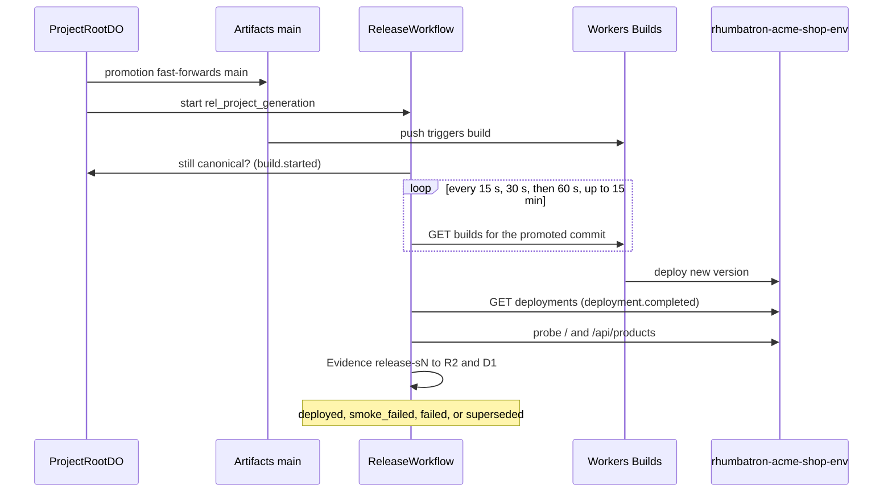

# Application Releases Runbook

Operations guide for application releases via Cloudflare Workers Builds, smoke verification, and failure injection.

## Principles

Rhumbatron manages application releases through git push triggers to Cloudflare Artifacts, verified by automated workflows and executable machine evidence (`AGENTS.md` sections 21.3 and 37, [ADR 0018](../adr/0018-release-via-workers-builds.md)).

**Status (2026-10-09): blocked.** The release path is built and applied. The Workers Builds connection from the Artifacts repo to `rhumbatron-acme-shop-dev` does not exist yet (see "One-Time Workers Builds Setup" below). Until it does, `ReleaseWorkflow` finds no build trigger and fails the release with reason `not_connected`.

---

## 1. How Releases Work ([ADR 0018](../adr/0018-release-via-workers-builds.md))

### Architecture



1. **Promotion Trigger**:
   - When a Candidate is accepted, promotion fast-forwards the canonical `main` branch in the project's Cloudflare Artifacts repository.
   - Promotion immediately starts `ReleaseWorkflow` with instance ID `rel_<project>_<generation>`.
   - **No Direct Deploy API Calls**: Rhumbatron never invokes a Workers Builds write API at runtime; the push to `main` triggers Workers Builds directly.
2. **Workers Builds Execution**:
   - Terraform manages the release target Worker shell (`cloudflare_worker.acme_shop`, `rhumbatron-acme-shop-<env>`).
   - Workers Builds owns the Worker's versions and deployments as runtime data, avoiding Terraform drift.
3. **Workflow Observation Steps** (`ReleaseWorkflow` on integration Worker):
   - **Verify Canonical**: Confirms generation is still canonical in `ProjectRootDO`. Sets state to `building` (`build.started`).
   - **Poll Builds**: Polls `GET /builds/workers/{tag}/builds` with backoff (15 s, 30 s, 60 s; up to 15 minutes). Verifies that the build trigger commit matches the promoted commit SHA.
   - **Confirm Deployment**: Confirms the active script deployment version via `GET /workers/scripts/{name}/deployments`. Emits `deployment.completed`.
   - **Probe Release URL**: Probes `/` (200), `/api/products` (200 JSON), and up to two contract routes added by the Change.
   - **Save Evidence**: Stores release evidence in R2 and D1 `evidence_index` under check ID `release-s<generation>`.
   - **Status Transition**: Transitions to `deployed` on success, or `smoke_failed` / `failed` on probe failure.
4. **Superseding**:
   - If a new generation is promoted while an existing release is `queued` or `building`, the earlier release is automatically marked `superseded`.
5. **Forward-Only Recovery**:
   - A failed release **never rolls back the Canonical Generation** and never deletes history.
   - Recovery is forward-only: promote a new generation (a fix or revert Change).

---

## 2. One-Time Workers Builds Setup

Connecting a project's Artifacts repository to Workers Builds is performed once per release Worker ([ADR 0014](../adr/0014-workers-builds-artifacts-connection.md), [ADR 0018](../adr/0018-release-via-workers-builds.md)):

### Option A: `cf` CLI Connection ([ADR 0018](../adr/0018-release-via-workers-builds.md))

```sh
cf builds workers create \
  --worker rhumbatron-acme-shop-<env> \
  --repo-namespace rhumbatron-projects-<env> \
  --repo <project-id> \
  --branch main \
  --deploy-command "npx wrangler@4.149.0 deploy"
```

### Option B: Cloudflare Dashboard ([ADR 0014](../adr/0014-workers-builds-artifacts-connection.md))

1. Go to Worker `rhumbatron-acme-shop-<env>` → **Settings** → **Builds**.
2. Click **Connect** → choose Artifacts namespace `rhumbatron-projects-<env>`.
3. Select the project repository and set production branch to `main`.
4. Set build command to `npx wrangler@4.149.0 deploy`.
5. Authorize with a dedicated build token.

### Runtime Token

`ReleaseWorkflow` observes builds using the sensitive Terraform variable `builds_api_token` (`rhumbatron-cloudflare-builds-token` in Keychain), bound as secret `BUILDS_API_TOKEN` on the integration Worker with permissions:
- `Workers Builds Configuration Edit`
- `Workers Scripts Read`

The worker performs read-only GET requests and never logs the token. Target configuration is recorded in D1 table `release_targets`.

---

## 3. Release Smoke Check (`smoke:release`)

Run automated release smoke tests against the deployed release target:

```sh
# Smoke check dev:
bun run smoke:release

# Smoke check prod (see the note below):
bun run smoke:release prod

# Smoke check a specific project:
bun run smoke:release dev --project <project-id>
```

- **Execution**: Connects using the Clerk smoke user credentials (`CLERK_SECRET_KEY` and `CLERK_SMOKE_USER_ID` from Keychain). The script loads the dev items (`rhumbatron-clerk-*-dev`). Prod uses the Clerk production instance, so a prod run needs prod smoke-user credentials in those variables.
- **Checks Verified**:
  - Release target is registered in `release_targets`.
  - Latest non-superseded release has status `deployed`.
  - Deployed `versionId` is recorded in D1.
  - Release smoke Evidence object is recorded in R2/D1.
  - Live HTTP probes against the app shell and products API return 200 OK.

---

## 4. Release Failure Injection (P13-12)

Simulate a production deployment failure without breaking canonical Git history:

```sh
bun run inject --only=release-smoke-failure
```

- **Mechanism**:
  - Targets the smoke user's `acme-shop-live` project on dev.
  - Calls `POST /v1/projects/:projectId/releases/inject-failure` (enabled by `FIXTURES_ENABLED = "true"`).
  - Probes the live release URL with standard probes plus missing route `/__rhumbatron/injected-missing-route`.
  - The resulting HTTP 404 triggers the standard failure path: marks the release `smoke_failed`, uploads Evidence `release-s<N>-injected` to R2, and emits event `release.smoke_failed` (`injected: true`).
- **Invariants Maintained**:
  - Canonical Generation stays unchanged (does not roll back).
  - Existing release and change history are fully preserved.
  - Recovery requires authoring and promoting a subsequent generation `S<N+1>`.
