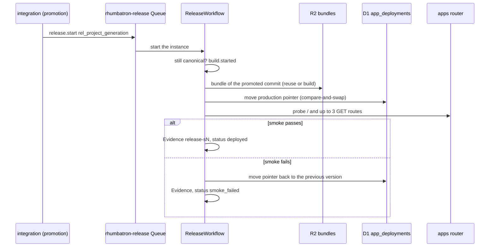

# Application Releases Runbook

This runbook covers how a promoted Candidate becomes a live app, and how to check a release.

Promotion advances the Canonical Generation. A release then serves the promoted commit. `ReleaseWorkflow` (`workers/integration/src/release-workflow.ts`) checks each release with executable Evidence (`AGENTS.md` sections 21.3 and 37). No model decides whether a release is authorized.

A release never deletes history. A failed release keeps the Canonical Generation. To recover, promote a new generation: a fix Change, or a rollback.

## 1. Live app release

Each Project has a live app at `<slug>.rhumbatron.com`. The apps Worker (`rhumbatron-apps-prod`) serves it through Dynamic Workers ([ADR 0020](../adr/0020-live-apps-dynamic-workers.md)). A deploy is runtime data: an R2 bundle and a D1 pointer (`app_deployments`). Terraform does not change for a deploy.

1. Start: promotion fast-forwards canonical `main` in the Artifacts repository of the Project. It records a `queued` release with the ID `rel_<project>_<generation>` and sends `release.start` on the `rhumbatron-release` Queue. The integration Worker starts `ReleaseWorkflow` with the release ID as the instance ID.
2. Check: the workflow confirms that the generation is still canonical. A newer promotion during the release sets the release to `superseded`.
3. Bundle: the workflow uses the stored bundle of the promoted commit, the bundle of the same tree, or the bundle of the Candidate preview. Otherwise it builds the bundle from the Artifacts source on the apps Worker. The cap is 60 builds per UTC day (`APP_BUILDS_PER_DAY`).
4. Pointer: the workflow moves the production pointer by compare-and-swap on the row that it read. The previous version stays.
5. Smoke check: the workflow probes the app through the apps router. It probes `/` (a real page, not a router status page) and up to 3 static `GET` routes from the route table of the app (`workers/integration/src/release-model.ts`). After a failed check, it waits 10 seconds and runs the check once more.
6. Evidence: the workflow stores release Evidence with the check ID `release-s<generation>` in R2 and in D1 `evidence_index`.
7. Status: a passed smoke check sets `deployed`. A failed smoke check moves the pointer back to the version it replaced and sets `smoke_failed`. A missing bundle or a failed build sets `failed`.

### Hosts

| Host | Serves |
|---|---|
| `<slug>.rhumbatron.com` | The production version. |
| `<previewId>--<slug>.rhumbatron.com` | The preview of one Candidate. A Change keeps at most 3 previews. The R2 lifecycle rule on `app-previews/` deletes preview bundles after 7 days. |
| `v0000001--<slug>.rhumbatron.com` | One kept version. The number is the Canonical Generation with 7 digits. |

A Project with no shipped Change shows "Nothing built yet". After "Remove app", the host answers 410.

### Rollback

A rollback to generation Sk is a new canonical transition from Sn to Sn+1. The new tree is equal to the tree of Sk. It takes the same path as every promotion, with the approval policy and the release.

### Stuck releases

Every 5 minutes, the event router cron queues `release.recover` for each Change that is `releasing` for more than 45 minutes (`RELEASE_STUCK_AFTER_MS`). It queues at most 10 per sweep. The integration Worker then does one of these:

- A finished release settles the Change to `completed` or `failed`.
- A release that is still `queued` or `building` is marked `failed`, and the Change fails.
- A Project without a live app completes the Change.
- A Project with a live app but no release gets a failed release record.

While `paused = true`, the cron does not run, so this recovery waits for the resume ([pause-resume.md](./pause-resume.md)).

## 2. Check a release

1. Open the Candidate page. The release panel shows the status, the version, and the smoke Evidence.
2. Run `bun run e2e prod`. On an empty Project, it checks the app host, versions, code reads, the rollback refusals, and "Remove app".
