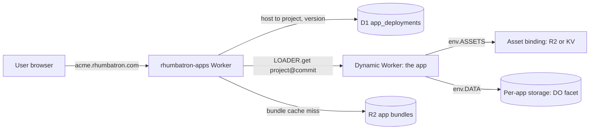
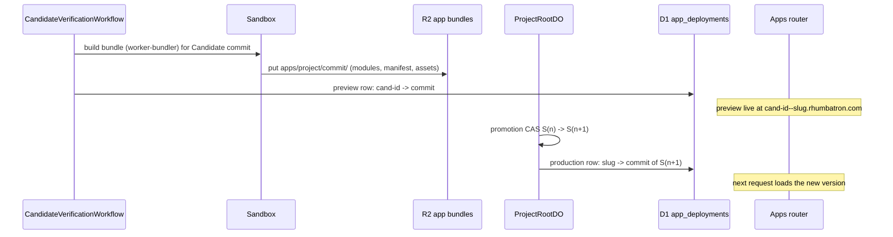
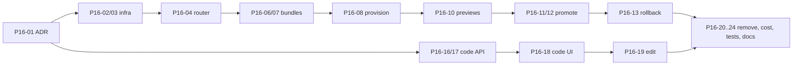

# Phase 16 plan: Live Apps

Status: draft for review, 2026-10-10. Nothing in this plan is built yet.

## 1. Goal

Every Project is a live application on Cloudflare.

A user can:

1. Create a Project. Rhumbatron deploys its first version at once.
2. Give instructions. Each instruction is a Change.
3. Open a preview of every Candidate before it ships.
4. Ship. A promoted Candidate becomes the live version.
5. Roll back to any earlier version.
6. Read the code at any version, and see what each agent changed.
7. Edit a file. The edit goes through the same checks as agent work.
8. Remove the app.

This makes the "next GitHub" story complete. The familiar parts are the repo, diffs, pull requests, checks, merge and deploy. The new parts are many agents, semantic conflicts, candidate futures and evidence-gated merge.

## 2. Where we stand

| Capability | Status today |
|---|---|
| Change, Work Graph, agents, conflicts, Candidates, checks | Works |
| Approval gate, compare-and-swap promotion, auto-promotion for low risk | Works |
| Deploy after promotion | Works for one hand-wired Project (Workers Builds, Acme Shop Live on dev) |
| Deploy for any Project | Missing |
| Preview per Candidate | Missing |
| Rollback | Missing (the protocol says "rollback is a new canonical transition", section 21.3) |
| Remove app | Missing (archive deletes source, but there is no app) |
| Read code at a version | Missing (Workspace page lists file paths only) |
| Diff per ChangeSet and per Candidate | Missing |
| Human edit of a file | Missing |

## 3. Decision: Dynamic Workers

Use Dynamic Workers (the Worker Loader binding). One router Worker serves every app. It loads the app code for the requested version into an isolate on demand.

Why:

- It is in the frozen stack (AGENTS.md section 5.3, "Dynamic Workers or Code Mode").
- It is included in our Workers Paid plan. It needs no new product and no new subscription.
- It needs no Worker per Project, no build token, and no dashboard step.
- Deploy is "write a bundle, move a pointer". It is fast and atomic.
- Previews cost nothing extra. A Candidate commit is one more version id.
- Isolation is built in: no network by default (`globalOutbound: null`), custom CPU limits, and only the bindings we pass.

Rejected options:

| Option | Why not |
|---|---|
| Workers Builds per Project | The Builds API rejects Artifacts connections (error 12065). It needs a dashboard click per Project and allows one concurrent build. |
| Workers for Platforms | $25 per month base fee. A new product. Not needed at our scale. |
| Direct script upload per Project | Needs a Workers Scripts Edit token at runtime. Creates one Worker per Project. |

### 3.1 Capacity on Workers Paid

Source: Dynamic Workers pricing page, checked 2026-10-10.

| Meter | Included per month | Our expected demo use |
|---|---|---|
| Unique Dynamic Workers created | 1,000 | About 1 per version or preview loaded per day. A demo uses 10 to 50. |
| Requests | 10 million (shared with Workers) | Hundreds |
| CPU time | 30 million ms (shared with Workers) | Small |

Answer to "is the Workers plan enough for one extra demo app": yes. It is enough for many demo apps. The limit that matters is Sandbox time for builds and checks: 5 hours per month per environment.

## 4. Architecture

### 4.1 Components

| Component | Kind | Responsibility |
|---|---|---|
| `workers/apps` (new) | Worker with `worker_loaders` binding | Maps host to Project and version. Loads the app. Serves previews and production. Returns a clear page for "no app yet" and "app removed". |
| `AppHostDO` (new, in `workers/apps`) | Durable Object, SQLite | Supervisor per app. Runs the app as a facet so it gets its own SQLite storage (Durable Object Facets). |
| App bundle builder | Step in the verification and release paths | Bundles the Project in the Sandbox. Stores modules, manifest and static assets in R2. |
| `app_deployments` (new D1 table) | Runtime data | `project_id, slug, channel (production or preview id), commit, generation, bundle_key, status, created_at`. |
| Code service (API) | Routes in `workers/api` | File tree, file content, ChangeSet diff, Candidate diff, version history. |
| Code viewer (web) | Pages in `apps/web` | File browser, file view, diffs, history. Built in the existing design. |

### 4.2 Domain (decided 2026-10-10)

Apps run on subdomains of rhumbatron.com, with no new zone. Live apps run in prod only (decided 2026-10-10). Dev keeps building, checking and promoting Projects, but it does not host apps.

| Host | Meaning |
|---|---|
| `<slug>.rhumbatron.com` | Production version of the app |
| `<candidate-short-id>--<slug>.rhumbatron.com` | Preview of one Candidate |

- All hosts are one level deep, so Universal SSL (`*.rhumbatron.com`) covers them. A two-level host such as `x.apps.rhumbatron.com` would need a paid certificate.
- In `envs/prod` only, Terraform adds a proxied wildcard DNS record `*` and one Worker route `*.rhumbatron.com/*` to the apps router.
- Explicit records keep priority. Workers custom domains (`dev`, `api`, `api-dev`, `www`, the apex) win over routes. The Clerk CNAMEs (`clerk`, `accounts`, `clkmail`, DKIM) are DNS-only, so no route touches them.
- Dev has no apps runtime, so P16 tests run on prod with test Projects that the e2e suite archives. Each step is small and reversible. One apply can remove the route and the wildcard record.
- Rhumbatron reserves the slugs that clash with Rhumbatron hosts: `www`, `api`, `dev`, `api-dev`, `clerk`, `accounts`, `clkmail`, and the DKIM hosts.

The router keeps cookies safe without a separate zone. It is the only path in and out of an app.

1. It removes the `Cookie` header from every request before the app sees it, except for cookies that the app set for its own host.
2. It drops any `Set-Cookie` from the app that names a `Domain` attribute, so an app cannot set cookies for rhumbatron.com or other apps.
3. P16-05 checks that the Clerk session cookie (`__session`) on rhumbatron.com is host-only. It must not be readable from app subdomains. The `__client` cookie lives on `clerk.rhumbatron.com` and is HttpOnly.

### 4.3 Apps have no real login

Generated apps do not use Clerk or any real identity provider.

- The app is open: anyone with the URL can use it.
- If an instruction asks for accounts, sign-in or roles, agents build a fake identity. This is a demo user picker or a "Sign in as Alice / Bob" switch, stored in a cookie on the app's own host. It has no passwords, no email and no third-party auth.
- The Acme template already has a fixture identity (`src/identity.ts`). P16-08 makes it default to a demo user, so the shop works in a browser without a header. Today `/api/products` returns 401 without the test identity.
- The context compiler adds this rule to every Task for an app Project: "Use the fake identity module for any auth need. Never add real authentication or collect credentials."
- A verification check flags an app bundle that references real auth SDKs or password fields (a static check, P16-05).

## 5. User flows

### 5.1 Create app

1. User creates a Project from a template (Acme Shop today; "empty Worker app" later).
2. Rhumbatron provisions the Artifacts repo (exists today).
3. A new `app.provision` command builds the S0 bundle and writes the production row.
4. The Project overview shows "Live at acme.rhumbatron.com" with an **Open app** link.

### 5.2 Instruction to live feature

1. User types an instruction. It becomes a Change (exists).
2. Agents work; a Candidate composes; checks run (exists).
3. **New:** the verification workflow builds the app bundle and publishes a preview. The Candidate page shows **Open preview**.
4. Promotion runs (exists). **New:** the production pointer moves in the same step that records `canonical.advanced`. Section 37 says the release is a data-plane operation, so no Terraform is involved.
5. A smoke check runs on the production host (reuse the `release-model.ts` probes). If it fails, the release becomes `smoke_failed`. The pointer then moves back to the previous version as a new transition.

### 5.3 Many instructions at once

- Independent Changes run in parallel and promote one after another.
- A Candidate whose base generation is out of date becomes `stale` (exists). **New:** Rhumbatron recomposes it on the new canonical state and verifies it again, up to 2 times. After that, it marks the Candidate blocked.

### 5.4 Rollback

- The Versions page lists S0..Sn, each with its commit, its Change, its time and an "Open" link to that version's live bundle (it is still in R2).
- **Roll back to Sk** creates a new canonical transition Sn -> Sn+1, whose tree equals Sk's tree. It needs approval if policy requires it. It never deletes history (sections 21.3 and 42.10).
- The production pointer moves to the bundle for Sk's commit. No rebuild is needed.

### 5.5 Remove app

- **Remove app** on Settings sets the app status to `removed`. The router answers 410 with a plain page.
- The existing archive flow then cleans up the source. It also deletes bundles (R2 prefix), facet storage (`facets.delete`) and deployment rows. After cleanup, the data is gone. The UI must say so.

### 5.6 View code

- **Code** tab on the Project: a file tree for any version (default: live), with file content and syntax highlighting.
- **Files changed** tab on the Change page and the Candidate page: a unified diff against the base generation.
- **History**: versions with their Changes and ChangeSets. Each ChangeSet shows its agent, Intent and diff.

### 5.7 Edit code

- **Edit** on a file opens an editor. **Save** creates a human ChangeSet on a new Change ("Edit src/catalog.ts by Sudhanva").
- That Change goes through the same Candidate and checks. Human edits never bypass Evidence. This keeps the core invariant: only verified Evidence advances the Canonical State.

## 6. Work breakdown

Each task is small and verifiable. The model column follows AGENTS.md section 22.

### Milestone P16-A: Apps runtime (deploy any Project)

| ID | Task | Model | Acceptance |
|---|---|---|---|
| P16-01 | ADR 0020: live apps on Dynamic Workers, rhumbatron.com subdomains, cookie isolation, fake identity, data model | Opus | ADR merged |
| P16-02 | Terraform (prod only): wildcard DNS record, Worker route `*.rhumbatron.com/*`, R2 prefix lifecycle, D1 migration `app_deployments` (both envs, harmless on dev) | Sonnet | Plan shows only these; no drift after apply; existing hosts unaffected |
| P16-03 | Terraform adapter for the `workers/apps` deploy: provider 5.27 has no `worker_loader` binding type; same pattern as `sandbox-deploy.ts` | Sonnet | `terraform apply` deploys it; re-run is a no-op |
| P16-04 | `workers/apps` router: host parse, pointer lookup (cached), `LOADER.get(project@commit)`, 404, 410 and "building" pages | Sonnet | Unit tests for host parsing; live request serves S0 |
| P16-05 | Security defaults: `globalOutbound: null`, CPU and subrequest limits, no Rhumbatron bindings, Cookie strip and `Set-Cookie` Domain drop, Clerk cookie host-only check, real-auth static check | Opus review | Test app cannot fetch the Internet, cannot read or set rhumbatron.com cookies; limit hit returns 503 |
| P16-06 | Bundle builder: Sandbox step with `@cloudflare/worker-bundler`, upload modules, manifest and assets to R2, content-addressed | Sonnet | Bundle for Acme S0 is stored and loads |
| P16-07 | Static assets: asset binding passed to the app (per the Dynamic Workers static assets guide) | Sonnet | Acme `public/` files serve from the app host |
| P16-08 | `app.provision` command on Project create; Acme fake identity defaults to a demo user; Project overview shows "Live at …" and **Open app** | Sonnet | New Project is live in under 2 minutes and works in a browser with no login |
| P16-09 | Per-app storage through Durable Object facets (`AppHostDO`). Acme keeps its in-memory store for the demo. | Opus design, Sonnet | Facet data survives an isolate restart |

### Milestone P16-B: Previews, promotion and rollback

| ID | Task | Model | Acceptance |
|---|---|---|---|
| P16-10 | Verification builds the Candidate bundle and writes the preview row; **Open preview** on the Candidate page | Sonnet | Two Candidates show two different live previews |
| P16-11 | Promotion moves the production pointer; release record and smoke reuse `release-model.ts` | Opus review | Promote S1 -> S2 serves S2 within seconds |
| P16-12 | Smoke failure rolls the pointer back as a new transition | Sonnet | Injected smoke failure leaves the old version live |
| P16-13 | Versions page and **Roll back to Sk** (new canonical transition, approval by policy) | Sonnet | Rollback S5 -> S6 (= S3 tree) serves S3 code |
| P16-14 | Stale Candidate auto-recompose and re-verify (max 2) | Opus design, Sonnet | Two parallel Changes both ship without manual steps |
| P16-15 | Retire the Workers Builds path for Acme Shop Live on dev (dev has no live apps after P16) | Sonnet | One deploy path in docs |

### Milestone P16-C: Code view and edit

| ID | Task | Model | Acceptance |
|---|---|---|---|
| P16-16 | Code store: file contents per tree in R2, content-addressed by blob, written by the indexer or the bundle step | Sonnet | Any promoted tree is readable |
| P16-17 | API: `GET /v1/projects/:id/code?tree=&path=`, `GET /v1/changesets/:id/diff`, `GET /v1/candidates/:id/diff`, `GET /v1/projects/:id/versions` | Sonnet | e2e covers each route |
| P16-18 | Web: Code tab (tree, file view), Files changed tabs, History, in the existing design | Sonnet | Manual check on dev and prod |
| P16-19 | Edit flow: file editor; save creates a human ChangeSet and Change; it goes through checks | Opus review, Sonnet | Human edit ships only after checks pass |

### Milestone P16-D: Remove, cost and hardening

| ID | Task | Model | Acceptance |
|---|---|---|---|
| P16-20 | **Remove app**: 410 at once; cleanup deletes bundles, facets and rows | Sonnet | Host returns 410; R2 prefix empty after sweep |
| P16-21 | Cost: count Dynamic Workers created, requests and CPU in `cost:report`; daily caps; alert at 80% | Haiku | Cost report shows the apps meters |
| P16-22 | Bundle retention: keep bundles for each promoted generation; delete preview bundles after 7 days | Haiku | Lifecycle rule in Terraform |
| P16-23 | Extend `bun run e2e` and the smoke tests: provision, preview, promote, rollback, remove, code routes (prod; dev skips the app checks) | Sonnet | e2e passes on prod; dev passes with app checks skipped |
| P16-24 | Docs: architecture page "Live apps", runbook updates, diagrams | Haiku | Diagrams parse |

### Order and parallel work

Streams A/B and C can run in parallel with separate file ownership. C touches `workers/api` routes, `workers/indexer` and `apps/web`. A/B touch `workers/apps`, `workers/integration` and `infrastructure`.

## 7. Demo script (target)

1. Create Project "Acme Shop". It is live at `acme.rhumbatron.com` in under 2 minutes.
2. Open the Code tab. Show `src/catalog.ts`.
3. Give 5 instructions at once. Two collide on purpose (wishlist and cart sharing).
4. Show agents working, the conflict card, and two Candidates with two live previews.
5. Candidate A fails p95; B passes. Open both previews.
6. Approve. S2 goes live. Refresh the app: the feature is there.
7. Show the Files changed tab for the shipped Candidate.
8. Roll back to S1. The app returns to the old version. Roll forward again.
9. Edit one line of copy in the Code tab. It ships after checks.
10. End on the convergence view.

## 8. Cost and limits

| Item | Expected | Guard |
|---|---|---|
| Dynamic Workers created | Under 100 per month | Count in `cost:report`; cap previews per Change (3, matches max Candidates) |
| Requests and CPU | Small | Per-app CPU limit; existing Workers meters |
| Sandbox build time | About 30 to 60 seconds per bundle | Reuse the verification Sandbox session; existing 5 h per month cap |
| R2 bundle storage | Under 100 MB | Lifecycle rule for previews |
| Domain | None (rhumbatron.com subdomains, Universal SSL) | None |
| Model spend | Unchanged per Change | Existing caps |

## 9. Risks

| Risk | Mitigation |
|---|---|
| Agent-written app reads or sets Rhumbatron cookies | Router strips `Cookie` and drops `Set-Cookie` with a `Domain`; Clerk session host-only check (P16-05) |
| An instruction asks for real login | Fake identity rule in every Task; static check fails real auth SDKs |
| App code runs too long or loops | Dynamic Worker CPU limits; `globalOutbound: null` |
| Terraform provider lacks the `worker_loader` binding | Adapter (P16-03) under section 11.4, with an ADR; replace when the provider adds it |
| Bundling fails for an app that is not Worker-shaped | Templates are Worker-shaped; the check fails with a clear message, never a silent pass |
| Dynamic Worker eviction adds cold-start latency | Stable ids per commit; bundle in R2 near the router |
| Rollback to a version whose data schema differs | Facet data is per app, not per version; rollback warns when a migration ran in between (follow-up) |

## 10. Decisions

Decided 2026-10-10:

- **Domain:** subdomains of rhumbatron.com (section 4.2).
- **Environments:** live apps in prod only; dev does not host apps.
- **Login:** generated apps have no real login; a fake identity when asked (section 4.3).

Still open:

- **D2, edit in v1:** yes (P16-19 in this phase), or view only first. Default in this plan: yes.
- **D4, tracking:** load this plan into Linear as milestone "P16 Live Apps" with one issue per task.
