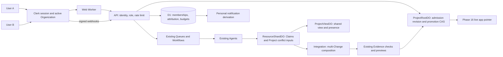
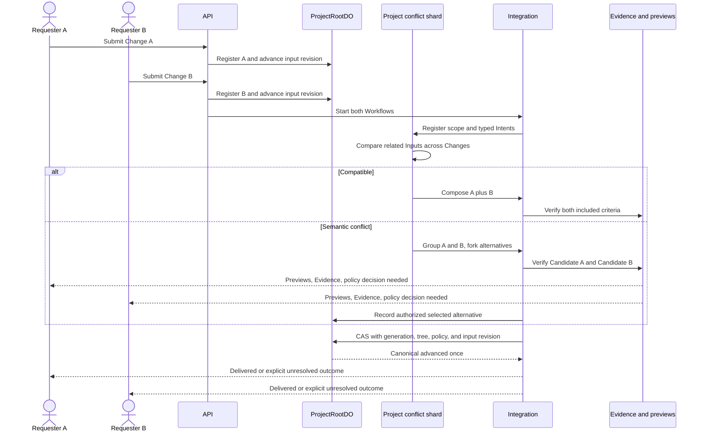
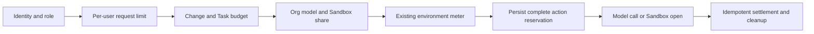
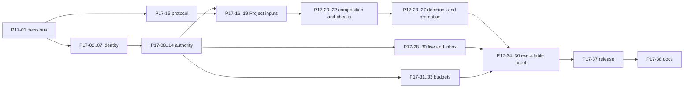

# Phase 17 plan: Teams

Status: draft for review, 2026-10-10. This document proposes work. It does not authorize a paid upgrade.

## 1. Goal

Several people can work on one live application.
Their email addresses can use different domains.
Rhumbatron must preserve each person's request.
Rhumbatron must combine compatible work.
Rhumbatron must expose incompatible work and apply a declared decision policy.

A user can:

1. Create a Team or accept an email invitation.
2. Select the active Team in the session.
3. Open the Team's Projects and see who requested each Change.
4. Submit a Change while another person works on the same app.
5. See compatible requests combine without a manual merge.
6. Compare competing Candidates and their previews when requests conflict.
7. See the decision, the Evidence, and the outcome of both requests.
8. See other people who have the Project open.
9. Receive a personal notification when work needs attention or finishes.
10. Use only the actions that the Team role permits.

In this phase, **Team** is the UI label for one Organization.
One Clerk Organization maps to one D1 organization.
An Organization owns Projects, memberships, policy defaults, and budget shares.
Nested teams and Project-specific membership are outside this phase.
Confirm this scope with the owner before implementation.

The release invariant stays unchanged:

> Many Agents can propose many futures. Only verified evidence can advance the Canonical State.

Team membership controls Rhumbatron access.
It does not add real login to generated apps.
Phase 16 still uses fake identity inside generated apps.

## 2. Where we stand

The source code is the baseline for this table.
Some architecture pages still describe the earlier Workers Builds path.
Phase 16 code now contains live app, rollback, code edit, and stale recompose paths.

| Capability | Status today | Main source |
|---|---|---|
| Clerk authentication | Works. The API verifies a token and checks `azp`. It retains only `sub`. | `workers/api/src/auth.ts` |
| Personal organization | `ensureIdentity` creates `usr_<Clerk subject>` and `org_<Clerk subject>`. A `user_*` subject produces `org_user_*`. | `workers/api/src/identity.ts` |
| Organization membership | D1 has `organizations`, `users`, and `memberships`. Roles are `owner`, `admin`, and `member`. | Migration `0001_init.sql` |
| Shared authorization | `canAccessProject` checks membership in any owning organization. It does not check the active organization or role. | `identity.ts`, API route files |
| Requester attribution | `changes.created_by` exists. Change response schemas and list views omit it. | `projects.ts`, `changes.ts` |
| Human edit attribution | The stored ChangeSet has a user actor. The API forwards a client-supplied `authorName`. | `code-edit.ts`, `human-edit.ts` |
| Approval attribution | `approver_user_id`, exact tree, and policy version exist. Email is fetched on the approval path. | Migration `0008_approvals.sql`, `candidates.ts` |
| Claims | Claims span a Project's resource shards. Contention records include the holder's Change. Claims are advisory. | `resource-shard-do.ts`, ADR 0015 |
| Cross-Change conflict signals | Available in Claim events and in the generic detector. The Agent caller excludes other Changes' Intents and contentions. End-to-end detection is missing. | `workers/agents/src/conflicts.ts` |
| Candidate composition | `planCandidateSets` handles dependency lineage and deferred work. Queries and Candidate ownership use one `change_id`. | `candidate-create.ts` |
| Verification | Compatibility, Evidence coverage, tree-bound approval, and promotion CAS work. Verification still uses `DEFAULT_POLICY`. | `candidate-composer.ts`, `verification-workflow.ts`, `packages/evidence` |
| Stale recompose | Reuses the same ChangeSets on a new base. Creates a new Candidate and runs checks again. Stops after two recompositions. | `recompose.ts`, migration `0019_app_releases.sql` |
| Live projection | ProjectViewDO sends snapshots and sequence deltas through hibernating sockets. Sockets have no user attachment. | `project-view-do.ts`, API `live.ts` |
| Notifications | Derives items from D1. Read marks are per user. Items currently include all accessible organizations and do not filter by action role or requester. | `notifications.ts`, migration `0012_notification_reads.sql` |
| Budgets | Model and Sandbox meters apply per environment and per Change. Organization shares and user request limits are missing. | `packages/model-router/src/spend-meter.ts`, Agent limits |
| E2E identity | `scripts/e2e.ts` uses one Clerk test user and creates Changes with `startPlanning: false`. | `scripts/e2e.ts` |

Do not report cross-Change detection as complete because Claims already cross Changes.
The caller explicitly filters Intents to `taskMap.has(i.taskId)` for the current Change.
It also filters contentions to `holderChangeId === ctx.changeId`.
Remove these restrictions only after the Project scope and release gate exist.

## 3. Decision: Clerk Organizations and explicit roles

Use the existing Clerk integration.
Use email invitations for any domain.
Do not infer membership from an email suffix.
Do not require a verified company domain.
Clerk supports invitations separately from domain enrollment. See [Organization invitations](https://clerk.com/docs/guides/organizations/add-members/invitations).

Enable Organizations in both Clerk instances during implementation.
Keep membership optional during legacy conversion so existing users can reach the migration page.
Require the active org in Rhumbatron product middleware throughout this transition.
After conversion, enable membership-required onboarding and hide the personal-account option.
Keep automatic first-organization creation and domain enrollment disabled.
Record these instance settings and test them before cutover. See [Organization settings](https://clerk.com/docs/guides/organizations/configure).

### 3.1 Session identity

Extend `AuthVariables` with the verified session ID, Clerk organization ID, and normalized organization role.
Keep signature, expiry, issuer, and authorized-party checks.
Keep prod strict about `azp`.

Use the installed Clerk SDK to normalize claims.
Version 2 tokens carry the active organization in `o.id` and the role in `o.rol`.
Support legacy claim fields only through a tested adapter if the deployed instance still needs them.
Reject unknown claim shapes. See [Session tokens](https://clerk.com/docs/guides/sessions/session-tokens).

Resolve a request context with these fields:

| Field | Source | Use |
|---|---|---|
| `userId` | Verified Clerk subject mapped to D1 | Actor and requester |
| `sessionId` | Verified session | Socket lifetime and revocation |
| `clerkOrgId` | Verified active organization claim | Provider membership scope |
| `orgId` | Unique D1 mapping for that Clerk organization and instance | Tenant identity |
| `role` | Current membership and the selected role mode | Deterministic authorization |
| `membershipVersion` | D1 membership revision | Reject stale authority |

Use the active organization for every Project read and mutation.
Membership in another organization does not authorize a request in the current context.
Require a Team selection for new Project work.
Permit identity, onboarding, invitations, and legacy migration routes without an active organization.

The web UI uses Clerk's organization switcher and `setActive`.
After a switch, refresh the token, close live sockets, clear the old Team's view, and reload data.
Include `userId` and `orgId` in Query keys, notification keys, and live state keys.
Cancel pending mutations when the Team changes.

An expected organization header or form value is an assertion only.
Compare it with the verified token context.
Return an organization mismatch when they differ.
Never use it to select another tenant.
This also protects two browser tabs from a session-cookie organization race.
Clerk documents the active organization and shared cookie behavior in [Organizations overview](https://clerk.com/docs/guides/organizations/overview).

### 3.2 Role model and Clerk tier gate

Clerk has built-in `org:admin` and `org:member` roles.
Production custom roles require the B2B Authentication add-on.
Do not assume that `org:owner` and `org:viewer` are available on the current production tier. See [Roles and Permissions](https://clerk.com/docs/guides/organizations/control-access/roles-and-permissions).

| Rhumbatron role | Clerk custom-role mode | Default-role mode without an upgrade |
|---|---|---|
| owner | `org:owner`; creator role | Clerk `org:admin` plus an explicit server-owned owner grant |
| admin | `org:admin` | Clerk `org:member` plus an explicit server-owned admin grant |
| member | `org:member` | Clerk `org:member` plus an explicit member grant |
| viewer | `org:viewer` | Clerk `org:member` plus an explicit viewer grant |

Default-role mode is the proposed cost-safe starting point.
Clerk owns membership existence and invite acceptance.
D1 owns the four Rhumbatron role grants in this mode.
Only the Rhumbatron API can change these grants.
Keep the creator as the only provider admin unless ownership transfers.
Rhumbatron admins manage invitations through the API.
This prevents a provider admin role from giving them broader organization powers than the app permits.

Store an invitation's intended Rhumbatron role in a server-owned invitation record.
Match it to the accepted provider invitation and membership.
A matching email alone is not an authorization proof.
An unrecognized membership receives viewer access until an owner grants a role.
Do not trust client metadata for a grant.

In custom-role mode, sync the four Clerk roles to D1.
Configure the creator and default roles explicitly.
Keep owner-only actions as API policy checks.
Unknown roles grant no mutation authority in either mode.
Do not expose unrestricted Clerk membership-management UI that bypasses this policy.

Permit one owner initially.
Transfer ownership with one serialized operation.
Do not remove or demote the last owner through the app.
An external provider deletion disables the Organization and raises an operator incident.
It must not delete Projects or silently create a replacement owner.

### 3.3 D1 sync

Replace automatic personal-org creation on every authenticated request.
Keep deterministic user IDs and existing Project IDs.

Add a signed Clerk webhook route to the existing API Worker.
Verify the raw body with Clerk's supported webhook verifier.
Reject an invalid signature before parsing or writing data.
Sync user, organization, membership, and invitation lifecycle events.
Use soft deletion for users and organizations that have history.
Keep request and approval attribution after membership removal.

Webhook sync is asynchronous.
Use an authenticated first-use reconciliation when a valid active-org session reaches a missing mapping.
Fetch only that organization and the caller's membership from Clerk.
Do not create a membership from the token's organization ID alone.
Clerk describes the sync pattern in [Sync Clerk data](https://clerk.com/docs/guides/development/webhooks/syncing).

Deduplicate webhook IDs.
Track provider update versions and deletion tombstones.
Do not let an older create or update restore a removed membership.
When event ordering is unclear, reconcile the current provider object before granting access.
Paginate repair work and use the existing Queue with bounded retries.
Keep a failed sync visible.

Check D1 membership on each request.
Recheck current provider membership and session state for approval, promotion, rollback, removal, and role changes.
Fail closed if this check cannot complete.
For ordinary reads, bound a verified membership snapshot to at most 60 seconds.
A removal through Rhumbatron first blocks D1 access, then removes provider membership.
If the provider call fails, keep the local block and retry the removal.
An external removal has a maximum 60-second read and socket lease; high-risk actions do not use that cache.

### 3.4 Migrate `org_user_*` Projects

Prefer conversion in place.
Attach a Clerk Organization ID to the existing D1 organization.
Do not copy the Projects to a new organization merely because the user accepted an invite.

1. Inventory personal organizations and their owner users.
2. Show the owner the Projects that conversion will share.
3. Let the owner create a Clerk Organization for this personal organization.
4. Persist a resumable migration operation before calling Clerk.
5. Record the provider result on that operation. Reconcile a lost response before another create.
6. Verify that the caller created and owns the provider organization.
7. Attach `clerk_org_id` to the existing D1 organization with a unique constraint.
8. Sync the owner membership and select this Organization in the session.
9. Invite the second person only after conversion completes.
10. Verify the same Project IDs, Canonical Generations, repos, R2 paths, slugs, and deployment pointers.

No source move, Sandbox start, app rebuild, or model call is needed.
ProjectRootDO already stores the same D1 `orgId`.
Existing ownership keys remain valid.

Create provider organizations only on explicit conversion or Team creation.
Do not create one for every user at sign-in.
This avoids unnecessary Clerk organization usage.

During rollout, a no-org session can read only its own unmigrated personal organization and run conversion.
It cannot read shared Projects or submit new work.
Remove this compatibility path after the inventory is migrated.

Moving a Project into an already existing Team is a separate transfer operation.
Defer it in the first slice unless the owner requires it.
Such a transfer must pause work, require source-owner and destination-owner approval, update DO ownership, and preserve history and budget charges.
Never implement it as an unguarded `UPDATE projects.org_id`.

## 4. Architecture

Use existing Workers, D1, R2, Queues, K2, Workflows, and DO classes.
Do not add a Cloudflare product, per-org database, per-org Queue, or per-org K2 stream.

### 4.1 Schema and protocol changes

Allocate new migration numbers after the last migration at implementation time.
Do not edit applied migrations.
Migration `0020_goal_suggestions.sql` already exists.
Use Terraform's existing migration adapter for remote schema changes.

| Object | Proposed change | Invariant |
|---|---|---|
| `organizations` | Add Clerk instance and organization mapping, sync state, role mode, and migration state. | Mapping is unique per provider instance. Disabled orgs grant no access. |
| `users` | Add display name, avatar reference, sync version, and deleted state. Update primary email. | Clerk subject remains the immutable identity. Email is display data. |
| `memberships` | Rebuild the role CHECK to add `viewer`. Add provider membership ID, active/revoked state, role origin, and version. | One current membership per `(org_id, user_id)`. No loss of existing roles. |
| Organization operations | Store invitation role grants and resumable conversion or ownership-transfer operations. | Stable operation IDs prevent duplicate invitations and org creation. |
| Webhook receipts | Store provider event ID, status, version, and bounded retention. | Duplicate or out-of-order delivery cannot expand authority. |
| `changes` | Retain `created_by`. Add requester display snapshot, submission kind, and explicit resolution state. | Never overwrite a requester's goal to combine requests. |
| Request idempotency | Replace `(project_id, client_request_id)` with `(project_id, created_by, client_request_id)`. Store a payload hash. | Same user's exact retry returns one Change. Two users can use the same key. Changed payload returns 409. |
| `conflicts` | Add `project_id` and revision scope. Keep `change_id` as a legacy anchor. Add `conflict_changes` with both side IDs. | One stable conflict ID for a pair. Both Change pages can find it. |
| Composition Groups | Add bounded group rows and group membership with input revision and policy version. | Freeze the participant set for each composition attempt. |
| `candidates` | Add Project and group identity. Keep `change_id` as the compatibility anchor. Add `candidate_changes`. | Anchor alone never means that other requests shipped. |
| `candidate_changes` | Record included criteria and ChangeSets, full or partial scope, and deferred or excluded criteria with reasons. | Every group member has an explicit outcome in every Candidate. |
| Conflict decisions | Store selected Candidate, actor, policy, reason, Evidence refs, input revision, and exact tree. | One authoritative selected outcome per decision revision. |
| `approvals` | Retain exact tree and policy binding. Add approver display snapshot and authority version. | Risk approval and conflict selection are separate gates. |
| Org budgets and reservations | Add limits, usage, and durable action reservations with allocation records. | No outbound paid action without every required reservation. |
| Notifications | Reuse `notification_reads`; add org scope to queries and group-aware recipient selection. | One user's read mark cannot affect another user. |

Add indexes for organization mappings, active memberships, Project conflicts, group members, Candidate members, and org usage periods.
Backfill each old Candidate as a one-Change group member.
Backfill `conflict_changes` from stored Intent task IDs where possible.
Label incomplete legacy attribution as unknown.
Do not invent a historical requester or decision.

Extend Zod request and response schemas before the UI consumes these fields.
Update `human-edit.ts` ID derivation as well as the SQL unique constraint.
Its current hash uses only Project and request key.
Include the verified user ID and an operation kind so two users cannot reuse one human edit result.
Version breaking Event and Command schema changes.
New Commands carry tenant identity and the actor or originating requester where applicable.
Old queued Commands can derive the tenant from the authoritative Project during a bounded transition.
Never derive it from user text.

### 4.2 Authorization matrix

Authorize an **action**, not only Project access.
Apply the same policy to HTTP routes, server functions, service RPCs, and queued user commands.
The API supplies verified context.
The integration Worker rechecks membership and policy for high-risk operations.

| Action | owner | admin | member | viewer |
|---|---|---|---|---|
| Read Team Projects, Changes, source, Evidence, activity, previews, and cost summaries | Yes | Yes | Yes | Yes |
| Create Project; submit Change; save human code edit | Yes | Yes | Yes | No |
| Cancel own Change before promotion | Yes | Yes | Yes | No |
| Cancel another person's Change | Yes | Yes | No | No |
| Compose a Candidate from authorized group inputs | Yes | Yes | Yes | No |
| Grant or reject a required risk approval | Yes | Yes | No | No |
| Request manual promotion | Yes | Yes | No | No |
| Roll back an app through a verified rollback Candidate | Yes | Yes | No | No |
| Remove app or archive Project | Yes | No | No | No |
| Decide a conflict under `owner_decides` | Yes | No | No | No |
| Select a verified alternative under `first_approved_wins` | Yes | Yes | No | No |
| Change Project decision policy or org budget allocation | Yes | No | No | No |
| Raise a Change budget within its existing org allocation | Yes | Yes | No | No |
| Invite member or viewer; revoke these invitations | Yes | Yes | No | No |
| Grant admin, transfer owner, remove admin, or change role mode | Yes | No | No | No |
| Remove member or viewer | Yes | Yes | No | No |
| Read own inbox; mark own items read; publish own presence | Yes | Yes | Yes | Yes |
| Retry or dismiss dead letters within the org | Yes | Yes | No | No |

An admin cannot convert an invitation to admin or owner.
A requester cannot approve by virtue of having created the Change.
An owner or admin can approve their own request by default; confirm whether a second approver is required.
Automatic low-risk promotion remains possible under Project policy.
It uses a system actor and passes all conflict and Evidence gates.
It does not give members a manual promotion capability.

### 4.3 Route coverage

Create one route-to-action registry.
Deny an unregistered product route by default.
Use it to drive critical authorization checks.
Preserve existing validation, CSRF, payload limits, and safe error responses.

Add these org routes to the existing API Worker:

| Proposed route | Action |
|---|---|
| `GET /v1/me`, `GET /v1/organizations` | Discover only the authenticated user's identity and memberships. No active org required. |
| `POST /v1/organizations` | Explicit Team creation; authenticated user; org creation throttle. |
| `POST /v1/organizations/personal/convert` | Convert only the caller's legacy organization; no active org required. |
| `GET /v1/organizations/current/members` | Read active org membership; all four roles. |
| `GET/POST /v1/organizations/current/invitations` | List or create invitations; owner/admin; role restrictions apply. |
| `POST /v1/organizations/current/invitations/:id/revoke` | Owner/admin; invitation must belong to the active org. |
| `PATCH /v1/organizations/current/members/:userId` | Owner role grant; admin can change member/viewer only; no self-escalation. |
| `DELETE /v1/organizations/current/members/:userId` | Owner; admin for member/viewer; last-owner protection. |
| `POST /v1/organizations/current/transfer-owner` | Current owner; verified destination membership and serialized operation. |
| `GET/PATCH /v1/organizations/current/budget` | Read summary for all roles; owner edits only within operator allocation. |
| `PATCH /v1/projects/:id/policy` | Owner-only versioned decision and release policy change. |
| `POST /v1/conflicts/:id/decide` | Conflict policy role; verified alternative; exact tree and input revision. |
| `POST /v1/webhooks/clerk` | Provider signature and deduplication only. No session authorization. |

Invitation acceptance uses Clerk's authenticated acceptance flow.
The app reconciles membership after acceptance; it does not accept a posted email as proof.

| Route surface | Required policy |
|---|---|
| `/health`, `GET /v1/version` | Public. No tenant data. |
| New identity and org discovery routes | Valid session. Return only the caller's organizations. |
| New org create, convert, invite, role, member, and policy routes | The corresponding matrix action. Invite acceptance proves the provider invitation and membership. |
| New Clerk webhook route | Valid provider signature; replay protection; no session middleware. |
| `GET /v1/projects` | Active org only. Include archived Projects only within that org. |
| `POST /v1/projects` | Create Project in active org; member or higher. |
| Project detail, snapshot, Changes, agents, events, stats, cost, verification, product graph, suggestions, workspace, workspace files | Read Project. All four roles. |
| Change detail, tasks, events, Claims, progress, decisions, conflicts, ChangeSets, Candidates | Read owning Project in active org. |
| Candidate detail, Evidence, output, screenshots, diff, preview metadata; ChangeSet diff; task workspace manifest | Resolve the child through its Project before read. All four roles. |
| Project code and versions; releases and app metadata | Read Project. Trees and R2 keys must belong to the Project. |
| `POST /v1/projects/:id/changes`, `POST /v1/projects/:id/code/edits` | Submit work; member or higher. Actor comes from context. |
| `POST /v1/changes/:id/cancel` | Cancel own work, or owner/admin. Reject after promotion begins. |
| `POST /v1/changes/:id/budget` | Raise Change budget; owner/admin; org and environment caps still apply. |
| `POST /v1/changes/:id/candidates` | Compose; member or higher; group validation rejects unauthorized subsets. |
| `POST /v1/changes/:id/approve`, `POST /v1/candidates/:id/promote` | Risk approval or manual promotion; owner/admin; current authority rechecked. |
| New conflict decision route | Selected conflict policy and matrix role; verified Candidate required. |
| `POST /v1/projects/:id/rollback` | Rollback; owner/admin; retain risk and tree gates. |
| `POST /v1/projects/:id/provision`, `POST /v1/projects/:id/app` | Provision or repair app; owner/admin; budget gate before execution. |
| `DELETE /v1/projects/:id/app`, `DELETE /v1/projects/:id` | Remove or archive; owner only. |
| Dead-letter reads, retry, dismiss | Reads for all roles; mutations for owner/admin. |
| `/v1/notifications`, `/count`, `/read` | Caller plus active org. Mark only caller-visible IDs. |
| WebSocket `/v1/projects/:id/live` | Read Project plus bounded user/session attachment. |
| `/v1/fixtures/projects`, fixture ChangeSets, Sandbox smoke, release failure injection | Explicit fixture/operator capability plus owner role. Keep environment flags. Deny ordinary users. |

Unknown or foreign resources return 404.
An authenticated viewer on an accessible Project gets 403 for a mutation.
A stale policy or conflicting operation returns 409.
A request rate limit returns 429 with `Retry-After`.
Do not start a Workflow, model call, or Sandbox before these checks pass.

Audit nested routers, including `changes.ts` mounted through `activity.ts`.
Audit web Evidence and live proxy routes as well as the API.
Fixture and test flags must never substitute for role checks.

### 4.4 Attribution

| Surface | Show |
|---|---|
| Change list and Change page | Requester name, submission time, submission kind, and unchanged goal |
| Code edit and diff | Human author or Agent author; originating requester; base tree |
| Candidate comparison | All requesters, included work, deferred work, and excluded criteria |
| History and versions | Every included Change and requester; promoter; approver; conflict decision actor |
| Approval card | Approver name, decision time, exact tree, policy version, and reason |
| Conflict card | Both goals, both requesters, resource, signals, previews, and selected policy |

Use immutable actor IDs for authorization and joins.
Use display names with email as a fallback inside the authorized Team.
Store a small display snapshot for audit history.
Keep the stable actor ID when a user renames or leaves.
Show a deleted-user label when display data must be removed.

Remove authority from `authorName` in edit requests.
Derive the human author from the verified identity.
Keep human edit actor and originating requester separate from the Agent that implements later work.
Record the requester on `change.created` and on downstream links.
The API currently does not emit `change.created`; add an idempotent outbox path.
Do not store private model reasoning in attribution or decision records.

### 4.5 Tenant isolation

Apply AGENTS.md section 40 at every boundary.
Use immutable Project IDs, not user names, email domains, or app slugs, as ownership keys.

| Boundary | Existing rule to retain | Work to add |
|---|---|---|
| ProjectRootDO and ProjectViewDO | `idFromName(projectId)`; Project ID is globally unique. Root stores `orgId`. | Store and assert org ownership in the view and every internal request context. |
| ResourceShardDO | `shardKey(projectId, resource)` returns `<project>:shard-NN`. Claims are Project-scoped. | Persist owner Project and org. Reject a different owner. Replace placeholder `tenantId = projectId` with the real org ID. |
| AgentDO | Logical Agent derives from a globally unique Task. | Verify Task -> Change -> Project -> org before start or resume. Assert immutable ownership in stored runs. |
| Sandbox | One Project Sandbox; separate run and Candidate directories. | Verify Project ownership before open/restore. Never share a writable instance across unrelated Projects or tenants. Retain `max_instances = 1`. |
| R2 | `source/<project>/`, `apps/<project>/<commit>/`, `evidence/<project>/`, `context/<project>/`, and `work-graphs/<project>/` | Centralize owned-key construction and validate row-derived refs. No caller-selected bucket key or unscoped fallback. |
| Artifacts | Environment namespace; canonical Project ID; workspace `ws-<run>`; Candidate `cand-<id>` | Derive names only from validated owner rows. Add Project/org to composition identity so group IDs cannot collide. Scope and revoke repo tokens. |
| Event and Command | Events carry tenant and Project. Commands currently lack tenant. | Normalize tenant from owner rows; check all child IDs; reject tenant mismatch before dispatch. |
| Vectorize and context | Retrieval is Project-based. | Require Project/org filters and validate citations against every included Change in the same Project. |
| Cache and UI | Resource cache keys use stable IDs. | Include active org and user for private responses. Clear on switch or revocation. |
| Cleanup | Deletes row-derived repos and Project prefixes. | Include all group members without traversing another Project. Never delete by org slug or broad namespace listing. |

Project identity in DO keys and R2 prefixes meets section 40 when ownership is enforced.
Do not rename existing keys solely to add an org prefix.
Conversion in place therefore preserves DO state and stored Evidence.
If explicit org-prefixed keys are chosen later, design a resumable migration first.
Never start using a new empty ProjectRootDO key for a live Project.

The audit archive currently groups several tenants by stream and day.
Treat those objects as operator-only storage.
Do not expose an archive batch through a tenant route.
Any tenant export must filter and write a Project-scoped object.

Generated app hosts remain public under Phase 16.
Authenticated preview metadata and Rhumbatron source stay tenant-scoped.
Team membership does not make a public app or preview URL private.
Confirm private preview access as a separate decision.
Retain Phase 16 cookie stripping, host-only Clerk cookies, and restricted app bindings.

### 4.6 Reuse the convergence engine

Keep a Change per user request.
Keep the original goal, requester, criteria, and Work Graph.
Do not merge user text into one anonymous goal.

| Existing mechanism | Reuse | Required extension |
|---|---|---|
| `detectConflicts` in `packages/conflict` | Typed resource, contract, data, assumption, protected-resource, and contention signals | Supply relevant Intents from all active Changes of the same Project. Preserve Task IDs and exact dependency edges. |
| Intent declaration on the Change shard | Stable Intent IDs, outbox, and duplicate checks | Add a bounded Project input registry and indexed Intent projection. Retrieve related inputs across different Change shards. |
| Advisory Claims | Project resource keys, 120-second leases, renew/release, `claim.contended`, holder Change ID | Include both sides in detection and notification. A Claim never becomes a user approval or exclusive edit lock. |
| Conflict review | Deterministic first pass; cited Sonnet review and Opus escalation | Include both goals and criterion IDs in the snapshot. Keep abstentions and unsupported findings as blockers. |
| `planCandidateSets` | Fork axis, shared work, transitive dependencies, `stackedOn`, and explicit `deferred` reasons | Run over the complete bounded group. Persist every deferred result. Do not truncate a dependency graph. |
| `checkCompatibility` | Base, dependencies, contracts, migration order, and source overlap | Validate selected ChangeSets against group membership and canonical lineage across Changes. File overlap alone can proceed to a real merge. |
| Verification Workflow | Isolated Candidate fork; checks; Evidence coverage gate; preview bundle | Load all member Changes. Use their criteria and invariants, maximum risk, and the active Project policy. |
| Tree-bound approvals | Exact composed tree and policy version; first decision per Candidate | Add separate conflict selection and current approver authority checks. No grant carries to a new tree. |
| ProjectRootDO CAS | Atomic generation/tree/policy check and outbox | Add input revision and selected conflict-decision checks in the same transaction. |
| `recomposeStaleCandidate` | New base, stable composition ID, new Workflow, full checks, maximum two retries | Carry all group members and unresolved outcomes. Recheck cross-Change semantics against the promoted state before recompose. |

The detector is a useful first pass, not a proof that arbitrary goals are compatible.
Two requests with unknown scope cannot bypass conflict review because they lack typed fields.
Compare declared acceptance criteria and protected invariants as well as implementation Intents.
Use bounded review only when deterministic signals are insufficient.
Use executable Evidence to decide technical questions.
Use a person to decide unresolved product preferences.

### 4.7 Concurrent input protocol

Add a **Composition Group**.
This is a bounded set of Changes considered in one integration round.
It is coordination data, not another user request.

1. Persist each incoming Change with requester, payload hash, and request ID.
2. Register it idempotently with ProjectRootDO before starting its Workflow or acknowledging it as admitted work.
3. Root advances an input revision. A failed registration leaves durable work in a visible admission-pending state.
4. Reconcile pending registration through the existing Queue. Do not lose the accepted D1 request.
5. Scope the Change through its Work Graph. Register scope readiness and later material Intent revisions.
6. Publish normalized Intent copies to a fixed Project conflict shard using the existing ResourceShardDO class.
7. Query only active or not-yet-delivered work and affected canonical lineage in that Project.
8. Compare the related set. Persist the conflict and both `conflict_changes` links.
9. Freeze a group membership, input revision, base generation, and policy version.
10. Compose compatible ready work together. Build alternatives when a real conflict exists.
11. Run checks and create Phase 16 previews.
12. Select an alternative by policy when required.
13. Promote only when Root still has the checked input revision and selected decision.
14. Update every included Change and record explicit outcomes for all other members.

Use one fixed Project conflict shard, not a scan of all 32 resource shards on every request.
The registry needs a repairable D1 projection and bounded indexed reads.
Keep canonical truth in Root and hot Claims on resource shards.
Root receives only admission, material input batches, decision state, and promotion boundaries.
It does not receive model token events, presence, ordinary Claim renewals, or every dashboard delta.

The input revision closes the race between conflict detection and promotion.
Mark a new material input as unchecked before it can participate.
Record the detection result only if its input revision is still current.
Root refuses promotion for unchecked relevant inputs or an outdated checked revision.
Do not trust an eventual ProjectViewDO snapshot or a separate pre-CAS SELECT for this gate.
Track expected Intent revision counts and a digest for each member Change.
Do not mark a detection revision checked until its registry inputs match those counts and digests.
A missing projection or failed declaration keeps release blocked and schedules bounded repair.

An input with unknown scope blocks release until scoping succeeds or a person explicitly defers it.
Once scope is known, unrelated Changes can proceed independently.
Use a bounded group of at most four ready Changes initially.
Overflow waits in creation order with a visible reason.
Use at most three root Candidates per group and no more than the existing cap for any member Change.
Handle one fork axis at a time.
Persist later conflicts and their dependent ChangeSets as deferred work.
Do not enumerate the Cartesian product of alternatives.

If compatible work is not ready together, ship it in sequence automatically.
The second Candidate recomposes on the new Canonical State and reruns its criteria.
Both requests must reach a recorded delivered state.
Users need no manual merge for this path.

### 4.8 Candidate semantics and verification

Define the composition key from org, Project, base generation/tree, sorted member Changes, selected ChangeSets, input revision, policy version, and composition rules version.
Sort deterministically.
A retry returns the same Candidate and Workflow.
The legacy anchor `change_id` is a stable member selected by ID order.
Use `candidate_changes` for lists, History, approvals, previews, cancellation, and release outcomes.

A compatible Candidate includes the union of selected requests' criteria and invariants.
Use the maximum risk tier and the strictest required checks.
Read `project_policies` for both verification and promotion.
Invalidate a plan when the active policy changes.
Do not keep verification on `DEFAULT_POLICY` while selection uses a different policy.

A competing Candidate includes shared compatible work and one conflict side.
Keep its dependencies complete.
Record which criteria of the other request it excludes.
Run common safety and invariant checks on both alternatives.
Show a criterion matrix for all requesters.
Only included criteria can satisfy a request's delivery gate.
An excluded preference is visible as excluded, not passed.
If shared protected invariants contradict, block both alternatives until authorized policy or scope changes.

Map criterion IDs to executable checks.
Generic build success does not prove both user goals.
Unmapped or missing criteria remain Evidence gaps.
Only `checked_supported` plus `pass` satisfies a required check.
A human decision cannot waive a required security check or turn a missing result into a pass.

### 4.9 Conflict decision policy

Store `crossChangeConflictPolicy` in the versioned Project policy.
Copy the org default when a Project is created.
An owner can change it through the authorized API.
Record policy changes and invalidate pending decisions that use the old version.
Default: `owner_decides`.

| Policy | Selection rule | Tie or insufficient Evidence |
|---|---|---|
| `owner_decides` | Owner selects a verified Candidate after seeing both requests, previews, and excluded criteria. Reason is required. | Keep both requests awaiting resolution. |
| `first_approved_wins` | First owner/admin selection accepted by the authoritative group CAS wins. The Candidate must be verified. | Concurrent later selections return the recorded winner with 409. Request arrival order is irrelevant. |
| `evidence_decides` | Deterministic comparator uses predeclared criteria, hard limits, and metric ordering from the policy. Select only a uniquely eligible winner. | Escalate to owner. No arbitrary ID or model-confidence tie-break. |

The current `approvals.candidate_id UNIQUE` rule prevents two decisions on one Candidate.
It does not prevent two sibling Candidates from being approved.
Add a group selection CAS in Root.
Bind selection to group revision, Candidate ID, exact tree, policy, actor, and Evidence IDs.
Persist the decision and outbox atomically.
D1 is its repairable view.

Conflict selection chooses a product future.
Risk approval authorizes a sensitive release.
Require both when both apply.
An evidence-selected authorization change still needs human risk approval.
Automatic low-risk promotion must wait for conflict selection too.
Recheck the decision actor's current authority before promotion.
If the actor lost the required role, block and request a new decision.

### 4.10 Preserve every request

| Outcome | Required state and user-visible result |
|---|---|
| All criteria delivered | Change completes after its promoted generation and release outcome are recorded. |
| Compatible portion delivered | Record partial delivery and generation. Keep remaining criteria open. |
| Work waiting for a dependency or later fork round | Persist deferred criterion/ChangeSet IDs, reason, and next eligible trigger. |
| Alternative not selected | Keep the Change in `awaiting_resolution` with `not_selected`, winning Candidate, decision actor, and reason. Notify its requester. |
| Requester cancels | Record an attributed cancellation. Invalidate group Candidates that still include that work. |
| Owner rejects further work | Record an explicit attributed rejection and notify the requester. Do not label it completed. |
| New request revises the old request | Create a linked Change with `supersedes`. Keep the original goal and resolution history. |

Add these states to protocol validators, change-status rules, workflow stop checks, causal routing, and notification derivation.
Do not mark every group member completed because the anchor Change promoted.
Do not automatically recompose a losing conflict side after the selected future ships.
That could undo the policy decision.
Recomposition is automatic only for compatible deferred work.
Conflicting residual work requires a new authorized decision or revised request.

### 4.11 Stale recompose and recovery

Reuse `recomposeDecision`, `MAX_RECOMPOSES = 2`, lineage fields, and stable Workflow starts.
Carry `candidate_changes`, criteria, deferred outcomes, and group identity to the replacement.
Do not copy old approval or selection authority to a different tree.

Before recomposition:

1. Load the current Canonical Generation and committed lineage.
2. Compare all remaining group requests against that state.
3. Remove only ChangeSets already proven included by commit ancestry and delivery records.
4. Preserve their requester attribution in History.
5. Check cancellation, membership, group decision, and budget state.
6. Recompose only a compatible set on the new base.
7. Run the required checks again and publish a new preview.

A source merge that succeeds is not proof that the second request remains satisfied.
The second request's acceptance checks and protected invariants must run on the new combined tree.
Record `blocked` attention after two recompositions or after an unresolved semantic conflict.
Keep the pending request intact.
Use the existing bounded recovery sweep for failed registration, lost starts, and projection repairs.
An Event replay must not create another Candidate, notification occurrence, decision, or release.

## 5. User flows

### 5.1 Create and join a Team

1. Alice creates a Team or converts her personal organization.
2. Alice invites Bob by email as a member. Bob uses a different email domain.
3. Clerk sends and validates the invitation.
4. Bob signs in, accepts, and selects the active Team.
5. The API reconciles membership if the webhook has not arrived.
6. Both users see the same Project IDs and live app.

Show invitation pending, accepted, revoked, and failed states.
Reject expired or revoked invitations.
Do not grant Project access while an invitation is merely pending.

### 5.2 Two compatible requests

1. Alice asks to add a product badge.
2. Bob asks to add a catalog filter.
3. Both Changes show their requesters.
4. Agents work in isolated Workspaces.
5. Rhumbatron combines ready compatible work in a Candidate.
6. Both requests' criteria pass.
7. Policy promotes it, or asks an authorized approver.
8. Both users receive delivery notifications.

If one request finishes later, stale recompose delivers it automatically on the newer base.
History still shows both requests and their authors.

### 5.3 Two conflicting requests

1. Alice asks for product prices with tax included.
2. Bob asks for the same displayed prices with tax excluded.
3. A deterministic fixture declares incompatible contract shapes for the same price field.
4. Rhumbatron links the conflict to both Changes.
5. It creates two Candidates with different previews.
6. Both requesters receive the conflict and preview notifications.
7. An owner decides by default. The decision names the excluded criterion.
8. Only the selected verified Candidate can promote.
9. The other request stays visible with its resolution action.

The owner can reject the residual request, defer it, or request a revised Change.
Rhumbatron must not silently treat it as delivered.

### 5.4 Presence and notifications

Reuse ProjectViewDO's hibernating WebSocket API.
Attach a trusted descriptor after API authorization: org, Project, user, session, membership version, and authorization expiry.
Strip client-supplied identity headers before the API builds this descriptor.
Never forward the Clerk token to the DO or put it in a URL.

Show a compact list of people with the Project open.
Track page location and optional file path.
Do not send keystrokes, unsaved source, cursor streams, or prompts as presence.
Deduplicate multiple tabs by user while retaining individual connection IDs.

Use socket attachments to restore presence after hibernation.
Send connect, location-change, and disconnect deltas.
Throttle location changes and heartbeats.
Expire the authorization lease in at most 60 seconds and reauthorize before further private broadcasts.
Keep the existing ping/pong auto-response; it is not authorization renewal.
Close removed members' sockets and close expired sockets before sending a private delta.
Use one bounded alarm only while presence leases exist; delete it when none remain.

Keep presence separate from the durable Project state sequence.
A lost presence update must not cause a false canonical-state gap.
Retain snapshot recovery for Project deltas.
Membership revocation invalidates user attachments even after hibernation.

| Notification | Recipients |
|---|---|
| Change progress, Candidate ready, delivery, rejection, budget stop | The originating requester; owner/admin for actionable failures |
| Cross-Change conflict, previews ready, decision recorded | Every affected requester; the role that can decide |
| Risk approval required | Current owners/admins; requester gets informational status |
| Promotion ready | Current owners/admins; no action item for viewers |
| Membership or role change | Affected user and owner; invitation mail remains Clerk's responsibility |

Derive items from authoritative rows as today.
Join group members and `conflict_changes` for both requesters.
Filter by caller, active org, current membership, and action permission.
Reuse stable IDs and per-user read marks.
A read mark clears the unread indicator; it does not hide an unresolved action.
Ensure cap or pagination behavior does not drop one requester from an open conflict.
Use shared live deltas only as an inbox invalidation signal.
Fetch personal items through the authenticated API.
Do not broadcast a user's inbox to all Project sockets.
No new notification email service is needed.

### 5.5 Budgets and rate limits

An Organization receives a share of the existing environment budget.
New organizations receive zero expensive-work allocation until an operator allocates a share.
Team creation must not multiply the account allowance.

Admission order:

| Meter | Scope | Proposed starting rule |
|---|---|---|
| Model spend | Org and calendar month | Operator allocation in integer micro-USD; sum of allocations cannot exceed the environment cap. |
| Sandbox time | Org and calendar month | Operator allocation in seconds; sum cannot exceed the environment cap. |
| Active reasoning work | Org | At most eight active agents across its Changes, within existing per-Change caps. |
| Sandbox admission | Org and environment | At most one active Project Sandbox slot; existing environment container cap remains one. |
| Candidate speculation | Composition Group and member Change | At most three root Candidates; two recompositions per lineage. |
| Work submission | Org plus user | Five new Change/edit requests per minute; twenty per hour. |
| User active work | Org plus user | Four open user-originated Changes; excess submissions get an explicit queue/limit result. |
| Other mutation routes | Org plus user plus action family | Twenty per minute; destructive and approval operations also use idempotency. |
| Invitation requests | Org plus user | Five per hour; provider limits apply too. |
| Global user abuse limit | User across organizations | Bound aggregate submissions so org switching cannot reset the allowance. |
| Private reads and live upgrades | User plus session | Bounded read and connection limits; at most four Project sockets per session initially. |

These are proposed app limits, not provider limits.
Confirm them with the owner.
Use conditional D1 counters and reservation rows.
Do not add Redis, a new rate-limit service, or paid WAF rules.

Extend the existing reserve/settle path for every model caller.
Include Root Planner, Pi, conflict review, retry compaction, and any model-backed suggestions.
Count Workers AI calls under their existing global caps and an org call allowance.
Keep `ALLOW_OPUS` unchanged.

Persist an action ID and every required reservation before dispatch.
For sequential org and environment reservations, compensate a known failed admission idempotently.
A crash keeps incomplete reservations pessimistically charged until repair.
Never execute when only one scope admitted the action.
Settle exactly once from recorded usage.
Unknown provider completion keeps its reservation.
Do not refund a timeout merely because no response arrived.

Reserve Sandbox startup, checks, build steps, and idle tail.
Use existing cleanup and sleep behavior.
Count a physical session once in the org meter.
Record logical Task allocations separately.
Do not count one shared session twice as actual billed use or exclude its idle tail.
Conservative accounting can retain the existing larger environment reservation until exact session accounting is proven.

Charge shared Candidate work once to the org.
Allocate its Change cost deterministically across included Changes, with stable rounding.
Charge branch-specific work to its included requests.
Reject admission if any allocated Change would exceed its remaining budget.
Never double-charge a retried composition or use a second requester to bypass a Change cap.

When an org share is exhausted, block new expensive work and identify the exact meter.
Keep code, requests, decisions, and Evidence readable.
Do not create another provider or upgrade the plan automatically.
An owner can request a larger share. Only the account operator can redistribute the fixed allowance.
Backpressure waits for a free execution slot without keeping a Sandbox idle.

## 6. Work breakdown

Each task is small and verifiable.
Model names are `opus`, `sonnet`, and `haiku`.
The coordinator creates one Linear issue per task in project `Rhumbatron` when implementation starts.
Use a title, one-line description, Area and Model labels, priority, and the phase milestone.
This planning task writes no Linear issues.
The coordinator reviews and commits implementation.

### Milestone P17-A: Shared identity and safe migration

| ID | Task | Model | Acceptance |
|---|---|---|---|
| P17-01 | ADR: org mapping, Team scope, role mode, migration, and revocation contract | opus | Owner confirms section 10 decisions; ADR identifies the production Clerk tier gate and has no automatic upgrade. |
| P17-02 | Add identity, membership, invitation-operation, and webhook-receipt D1 migrations | sonnet | Local migration preserves existing rows; viewer role works; mappings are unique; duplicate webhook and old update tests pass. |
| P17-03 | Normalize active-org session claims and resolve request context | sonnet | Signed v2 token resolves the correct org; missing, unknown, forged, wrong-instance, and inactive-org contexts fail safely; prod `azp` remains strict. |
| P17-04 | Implement signed Clerk sync and first-use reconciliation | sonnet | Invite acceptance works before webhook delivery; removal, duplicate, out-of-order, and provider-outage cases cannot grant extra access. |
| P17-05 | Add org creation, invitation, role, removal, and ownership-transfer API | sonnet | Any-domain invite works; admin cannot grant admin/owner; last owner is protected; repeated operation returns the same result. |
| P17-06 | Implement personal-org conversion with inventory and repair state | sonnet | One legacy owner converts twice without a second org; all Project IDs, trees, generations, and live URLs remain unchanged; another user cannot claim the mapping. |
| P17-07 | Add Team selection, onboarding, and member settings UI | sonnet | Second user joins and sees the same Project; switch clears cached data and live state; org mismatch blocks pending mutation. |

### Milestone P17-B: Authorization, attribution, and tenant isolation

| ID | Task | Model | Acceptance |
|---|---|---|---|
| P17-08 | Implement deterministic action policy and route registry | sonnet | Matrix roles match policy; foreign tenant gets 404; viewer mutations get 403; unknown product routes deny access. |
| P17-09 | Apply policy to all API and web proxy routes | sonnet | Every route in section 4.3 has an action; fixture routes require operator capability; denied calls start no expensive work. |
| P17-10 | Recheck authority at integration RPC, queued mutation, and promotion boundaries | sonnet | Member removal and admin demotion between request and execution block sensitive work; system promotion cannot bypass a conflict gate. |
| P17-11 | Add requester and actor fields to protocols and stored audit snapshots | sonnet | Change, edit, approval, cancellation, rollback, and removal use verified actor IDs; same request key from two users creates two Changes. |
| P17-12 | Show attribution in Change list, Code, History, and Candidate views | sonnet | Both requesters and all included Changes appear; renamed/deleted users retain accurate historical labels; forged edit author has no effect. |
| P17-13 | Centralize and enforce owner checks for DO keys, R2 refs, Artifacts, and commands | sonnet | Forged Project/child/key combinations fail; legacy keys still restore; cleanup reaches only the owned Project. |
| P17-14 | Review identity, migration, and tenant security boundaries | opus | Critical boundary tests pass; no cross-tenant source, Evidence, socket, or capability access remains; production role mode is explicit. |

### Milestone P17-C: Concurrent requests and convergence

| ID | Task | Model | Acceptance |
|---|---|---|---|
| P17-15 | Define group, criterion outcome, input revision, and conflict-decision protocols | opus | Protocol handles compatible, partial, deferred, losing, cancelled, and stale work; owner reviews promotion race and outcome invariants. |
| P17-16 | Add group, Candidate-member, conflict-member, and decision migrations | sonnet | Old Candidates remain readable as one-member groups; foreign Project members are rejected; lookup indexes support both Change pages. |
| P17-17 | Add Project admission and revision fencing | sonnet | New relevant input between detection and CAS blocks release; duplicate registration is a no-op; a lost registration is repaired without losing the Change. |
| P17-18 | Register Project Intents and detect cross-Change conflicts | sonnet | Two Changes on different Change shards produce one linked conflict; advisory contention alone stays suspected; unrelated Projects never compare. |
| P17-19 | Route human edits through the same Project detection path | sonnet | Two human edits use verified authors and cross-Change Intent detection; stale base gets 409; textual merge success cannot skip semantic checks. |
| P17-20 | Compose compatible groups with complete dependency lineage | sonnet | One Candidate can include both users' ChangeSets; retries yield one Candidate; omitted dependencies and unauthorized subset requests fail. |
| P17-21 | Build bounded competing Candidates with persisted deferred outcomes | sonnet | Two real alternatives have distinct previews; shared work is in both; later conflict work has stored reasons; caps hold under concurrent creates. |
| P17-22 | Verify all included criteria under the active Project policy | sonnet | Maximum risk and union invariants apply; criterion gaps block; both requester criteria run for a combined Candidate; stored policy drives verification and promotion. |
| P17-23 | Implement three selection policies and authoritative group decision CAS | sonnet | Owner-only selection, first accepted approval race, deterministic Evidence winner, and tie-to-owner cases pass; no model score authorizes promotion. |
| P17-24 | Extend promotion and release bookkeeping to every group member | sonnet | One CAS advances once; only fully delivered Changes complete; risk approval and selection both apply; replay repairs D1 without a second release. |
| P17-25 | Extend stale recompose, cancellation, and losing-request recovery | sonnet | Compatible stale work ships on the new base; losing conflict side never ships automatically; two-recompose limit preserves visible residual work; cancellation invalidates affected Candidates. |
| P17-26 | Add shared conflict comparison and resolution UI | sonnet | Both goals, requesters, criterion outcomes, previews, policy, decision actor, and residual actions are visible; role-disabled controls match the API. |
| P17-27 | Review convergence and promotion consistency | opus | Race tests prove no unchecked input bypasses CAS; sibling winners cannot both release; no request disappears or receives false completion. |

### Milestone P17-D: Presence, notifications, and budget shares

| ID | Task | Model | Acceptance |
|---|---|---|---|
| P17-28 | Add authenticated socket attachments and presence leases | sonnet | Two users appear; duplicate tabs deduplicate; hibernation preserves identity; expiry and member removal stop private broadcasts within the lease bound. |
| P17-29 | Add presence UI and org-scoped live/query lifecycle | sonnet | Team switch closes old sockets and clears state; a Project sequence gap still requests a fresh snapshot; presence loss does not affect canonical state. |
| P17-30 | Extend notification recipients and action-role filtering | sonnet | Both requesters get conflict and decision items; viewer gets no approval action; Alice's read mark leaves Bob unread; removed users see no Team items. |
| P17-31 | Add org budget limits, reservations, and per-user rate meters | sonnet | Concurrent calls cannot overspend org or environment caps; partial reservations cannot dispatch; repeat settlement is a no-op; switching org does not reset the global user cap. |
| P17-32 | Apply org admission to all model, Sandbox, verification, and build paths | sonnet | Planner, Pi, review, compaction, and app build honor shares; shared Candidate cost is charged once; timeout holds reservation; no idle Sandbox remains after work. |
| P17-33 | Extend Costs and cost report with org shares and requester allocation | haiku | Report shows allocation, reserved, settled, remaining, and blocked meter; totals reconcile to existing environment usage without multiplying the allowance. |

### Milestone P17-E: Executable proof and release

| ID | Task | Model | Acceptance |
|---|---|---|---|
| P17-34 | Add critical deterministic identity, role, convergence, and budget tests | sonnet | Section 7 critical cases pass with model gateway fail-on-call; no coverage target or trivial UI tests are added. |
| P17-35 | Extend API e2e with the second Clerk test user and real shared-org sessions | sonnet | Different-domain users share one org, create separately attributed Changes, obey role limits, isolate read marks, and fail access after removal; model spend stays zero. |
| P17-36 | Add two-browser collaboration e2e and deterministic Candidate fixtures | sonnet | Compatible and conflicting requests follow section 7; previews differ; race has one winner; residual request stays visible; prod/live tests clean up all temporary work. |
| P17-37 | Release through Terraform with unchanged product and cost envelope | sonnet | Reviewed plan adds no Cloudflare product or increased compute cap; migration and bundles apply; drift check and bounded two-user smoke pass. |
| P17-38 | Update architecture, operations, and demo documents | haiku | Diagrams parse; runbook covers conversion, sync repair, revocation, shares, selection, and teardown; built status is separate from this plan. |

### Order and parallel work

Fix the identity and protocol interfaces before independent work starts.
Live/inbox and budgets can proceed while composition develops.
Assign separate file ownership.
Serialize edits to `packages/protocol`, API route mounts, `project-root-do.ts`, and verification/promotion files.
Each implementation task must have the section 46 handoff, cost limit, and Evidence reference.
Stop a task when its acceptance criteria pass.

## 7. Demo script and verification

### 7.1 Critical deterministic tests

| Boundary | Required tests | Spend |
|---|---|---|
| Identity | Active org mismatch; unknown claims; wrong Clerk instance; forged org; no-org shared access denied | No model or Sandbox |
| Sync | Duplicate delivery; delete then older update; accepted invite before webhook; provider outage; conversion retry after lost response | No model or Sandbox |
| Authorization | Role matrix; nested child from another Project; operator fixture guard; revocation before approval/promotion; last-owner removal | No model or Sandbox |
| Request identity | Two users reuse one request key; same-user retry; changed payload; forged edit author | No model or Sandbox |
| Tenant ownership | DO owner assertion; R2 path traversal and foreign ref; Artifacts fork ownership; cleanup boundary | No model or Sandbox |
| Conflict detection | Cross-Change pair on different shards; benign additive pair; contention-only suspicion; contradictory criteria; terminal Intent filtering | No model or Sandbox |
| Composition | Dependency and `stackedOn` closure; group caps under concurrency; multi-conflict deferral; no unrecorded omission | No model or Sandbox |
| Selection and CAS | Two simultaneous approvals; new input after verification; policy change; approval tree mismatch; revoked approver; system auto-promotion blocked by conflict | No model or Sandbox |
| Delivery | Partial request stays open; losing side stays visible; cancellation invalidates group; stale recompose carries both authors and reruns criteria | No model in deterministic harness |
| Budgets | Last allowance race; partial admission rollback; pessimistic unknown completion; retry settlement; shared-cost rounding; org-switch rate bypass | No outbound paid action |
| Presence and inbox | Hibernation identity; multi-tab dedupe; expired lease cannot receive data; per-user read state; role-filtered actions; both conflict recipients | No model or Sandbox |

Use Vitest for critical protocols and security boundaries.
Use local D1 and DO integration where platform behavior matters.
Test the existing implementation paths, not a second mock convergence engine.
Do not test trivial framework wrappers or add a coverage target.

### 7.2 Zero-model API e2e

Extend `scripts/e2e.ts` to hold two independent sessions.
Use the existing first Clerk test user and the second Clerk test user.
Read IDs and credentials from environment or Keychain.
Add an explicit second-user setting, such as `CLERK_SMOKE_USER_ID_2`.
Fail this suite as incomplete if the second identity is missing.
Do not silently replace it with the first user.

1. Create or convert a temporary test Team with user A as owner.
2. Invite user B with a different email domain and accept through Clerk.
3. Mint or obtain real tokens with that Organization active for both sessions.
4. Retain the production ticket sign-in path with valid `azp`.
5. Confirm both users see the same temporary Project.
6. Submit two Changes with `startPlanning: false` and the same client request key.
7. Assert distinct IDs and correct requesters.
8. Check member, viewer, and admin actions by changing B's authorized role and refreshing context.
9. Verify notification read independence and live presence.
10. Remove B and check HTTP plus socket denial, including the existing socket.
11. Check a Project in A's separate organization is not reachable from the shared active org.
12. Revoke both test sessions and invitations. Archive only temporary test Projects and remove temporary memberships/orgs in `finally`.

This suite starts no Planner, Agent, or Sandbox.
It performs no Candidate verification or app provisioning.
Model spend must remain exactly zero.

### 7.3 Deterministic convergence e2e

Use two Playwright browser contexts for UI checks when needed.
Use real Clerk sessions for both people.
Inject fixed Work Graphs, Intents, and prebuilt ChangeSet commits through existing fixture infrastructure.
Keep fixture capability restricted to isolated tests and explicit operator access.
Do not add a public production model-bypass endpoint.

Run three cases:

| Case | Proof |
|---|---|
| Compatible requests | Both people submit different inputs. One combined Candidate or automatic sequential recomposition delivers both. Criterion checks run on the final tree. History shows both. |
| Semantic conflict | Fixed contradictory price contracts merge textually but produce a conflict. Both people get notifications. Two previews show the alternatives. Default owner policy selects one. Losing request remains visible. |
| Promotion race and stale work | Two allowed decisions race under `first_approved_wins`. One group winner and one canonical transition exist. Independent stale work recomposes and preserves the selected future. |

Repeat the conflict case under `evidence_decides` with fixed measured results.
Include a tie that requires the owner.
Include an authorization-sensitive Candidate that still needs human approval.
Block model transports in the fixture suite and assert zero calls and zero token spend.

Local tests use fixed source fixtures and emulated bindings where possible.
A bounded live test may use the existing Sandbox and Artifacts to execute real composition and checks.
That test has zero model spend, but it can consume Sandbox and storage allowance.
Check remaining meters before it starts and enforce a test time budget.
Do not call this path cost-free.

Live apps and previews exist in prod under Phase 16.
Dev tests must report app-host checks as unavailable, not passed.
Run the bounded prod live flow only with temporary test Projects and current allowance.
Delete preview rows and forks through the existing cleanup path.
Close servers, tokens, sessions, and Sandboxes even after failure.

### 7.4 Demo target

1. Show Alice's Team and invite Bob from another email domain.
2. Open the same app in both sessions. Show presence.
3. Submit two compatible requests. Show both names and both delivered criteria.
4. Submit two contradictory requests. Show the shared conflict card.
5. Open both previews and compare the criterion matrix.
6. Select under owner policy and approve the sensitive action if required.
7. Show one canonical advance and the live result.
8. Open the losing request. Show its explicit reason and remaining action.
9. Show independent inbox read state and the Team budget share.
10. Change Bob to viewer and show a denied edit.

## 8. Cost and limits

No new Cloudflare products are required.
Keep the current Workers plan and approved environment shares.
Do not raise `max_instances`, enable Opus, add per-org streams, or increase Gateway limits for this phase.

| Item | Expected effect | Guard |
|---|---|---|
| Workers and DO requests | More authenticated users and socket lifecycle requests | Hibernation, bounded leases, connection caps, and per-user rate limits |
| D1 reads/writes | Membership checks, indexed group joins, reservations, and read marks | Indexed bounded queries; no full-tenant scans; webhook dedupe |
| K2 and Queues | Group and attribution events on existing transport | Stable IDs; no per-org resources; bounded repair and causal wakeups |
| Model spend | More requests can compete for the same fixed allowance | Org shares, Change allocations, existing environment meter, no automatic cap increase |
| Sandbox time | Group checks and previews consume the existing share | Reuse verification session; count idle tail; one container instance; cleanup and sleep |
| R2 and Artifacts | Extra competing forks and previews | Existing Candidate caps, preview retention, scoped sweep, no source copy during conversion |
| Browser checks | Two-person UI proof | Local Playwright where possible; bounded live runs within existing Browser Run allowance |
| Notification delivery | More derived in-app items | Existing D1 derivation and live invalidation; no email product |

The current repository documents model allowances of $15 dev and $10 prod per month.
It documents Sandbox shares of 18,000 seconds dev and 54,000 seconds prod per month.
These are app-enforced approved caps, not new provider entitlements.
Read actual Terraform variables and remaining meters before release.
Do not use the older Phase 16 statement of five Sandbox hours in each environment as authority.

The supplied Clerk Organizations research file became available during final review.
The table incorporates its findings and official sources checked on 2026-10-10.
Confirm the actual settings and entitlements of both existing instances before release.
Clerk measures Monthly Retained Organizations (MROs).
An MRO has at least two members and at least one Monthly Retained User.
See [Organizations overview](https://clerk.com/docs/guides/organizations/overview).

| Clerk item | Limit or price | Release action |
|---|---|---|
| Included MROs in dev | 50 on the free development instance. [Overview](https://clerk.com/docs/guides/organizations/overview). | Count existing usage before creating test Teams. |
| Included MROs in prod | 100 per application; included on Hobby and Pro. [Pricing](https://clerk.com/pricing). | Monitor retained usage; total created org count is a different measure. |
| Included members per Organization | Default 5; configurable up to 20 without the enhanced B2B add-on. [Organization settings](https://clerk.com/docs/guides/organizations/configure), [Pricing](https://clerk.com/pricing). | Confirm the configured value. The two-user demo fits either setting. |
| Organization creation limit per user | Default 100; configurable. [Organization settings](https://clerk.com/docs/guides/organizations/configure). | Set a lower app limit; convert on demand. |
| Organization overage | Enhanced B2B required beyond the included 100 MROs; additional MROs cost $1 each per month. One-month grace period. [Pricing](https://clerk.com/pricing). | Do not treat grace as free recurring allowance. Block growth before a billing gate. |
| Enhanced B2B Authentication | $100/month, or $85/month billed annually. Includes custom roles and unlimited org members. [Pricing](https://clerk.com/pricing). | Not needed for the proposed default-role mode. Owner approval required to enable it. |
| Clerk Pro | $25/month, or $20/month billed annually. Pro alone does not supply production custom roles. [Pricing](https://clerk.com/pricing). | No Pro upgrade is required by this plan. |
| Organization invitation API | Single-invite endpoint: 250 requests/hour. Bulk: 50 requests/hour, at most 10 invitations/request. [Rate limits](https://clerk.com/docs/guides/how-clerk-works/system-limits), [Invitations](https://clerk.com/docs/guides/organizations/add-members/invitations). | App throttle is lower. Respect provider 429 and `Retry-After`. |
| General Backend API | Dev: 100 requests/10 seconds. Prod: 1,000 requests/10 seconds. [Rate limits](https://clerk.com/docs/guides/how-clerk-works/system-limits). | Bound reconciliation and authorization lookups; no full-org polling loop. |
| Total invitation volume cap | Research found no separate published cap; instance entitlement is to confirm. | Do not interpret an undocumented cap as unlimited usage. |

The custom-role production tier requirement is documented in section 3.2.
Recheck [Clerk pricing](https://clerk.com/pricing) and the instance's entitlements before rollout.
If any required setting can bill, stop before enabling it and obtain owner approval.
Never attach unverified pricing claims to an automatic upgrade.

Use Terraform plan before apply for Worker releases, secrets/bindings, and D1 migrations.
The plan must show no additional Cloudflare products and no increased execution allowance.
Keep Clerk instance configuration separate from Cloudflare control-plane configuration.
Record provider configuration and test it before production use.
This planning pass performs no remote change.

## 9. Risks

| Risk | Mitigation |
|---|---|
| Clerk custom roles need a paid add-on | Explicit role modes; four app roles in D1 by default; owner decision before any upgrade. |
| A valid stale token restores a removed member | Current D1 state and tombstones; high-risk provider check; bounded read/socket lease; no token-only membership upsert. |
| Two tabs send a request under the wrong active org | Expected-org assertion against verified context; cache isolation; cancel pending mutation on switch. |
| Same request ID merges two users' inputs | Requester-scoped unique key and payload hash for goal and edit paths. |
| Project-level detection misses Intents on another Change shard | Fixed Project registry, indexed related-input projection, and repair before release gate. |
| A new request arrives between checks and promotion | Root input revision checked in the promotion transaction. |
| Both sibling Candidates have approval rows | Separate authoritative group-selection CAS; approval alone is not selection. |
| Stale recompose undoes the winning preference | Recheck selected future; no automatic recompose of losing conflict work. |
| Group promotion falsely completes the losing or partial request | Per-Change criterion outcomes and explicit residual states. |
| Two users double the Sandbox or model allowance | Fixed org allocations within the same environment meter; complete reservations before work. |
| Presence keeps DO compute awake | Hibernation attachments, throttled updates, auto ping/pong, bounded lease alarm, no alarm after last socket. |
| Cleanup deletes another tenant's repos or Evidence | Immutable owner joins, validated derived names, Project-scoped prefixes, and boundary tests. |
| Team UI implies private generated apps | State Phase 16 public-host behavior clearly; make private previews a separate owner decision. |
| Membership sync or release projection fails | Durable operation records, outbox, idempotent replay, bounded recovery, visible blocked state. |

## 10. Decisions to confirm with the owner

| ID | Decision | Proposed default | Required before |
|---|---|---|---|
| D17-01 | Does Team mean one Organization, or a subgroup within an Organization? | One Organization in this phase. | P17-01 |
| D17-02 | Enable paid Clerk custom roles, or use default provider roles plus Rhumbatron grants? | Default-role mode; no upgrade. | P17-02..05 |
| D17-03 | How should legacy personal Projects become shared? | Convert the existing D1 organization in place; no automatic transfer on invite. | P17-06 |
| D17-04 | Is transfer into an existing Team required now? | Defer; conversion satisfies the first shared-Team flow. | Migration scope |
| D17-05 | Which cross-Change decision policy is the org default? | `owner_decides`; allow all three versioned Project options. | P17-15 |
| D17-06 | Can an owner/admin approve their own sensitive request? | Yes; member requesters still cannot approve. | P17-08 and P17-23 |
| D17-07 | Can admins roll back? Who can remove an app? | Owner/admin rollback; owner-only removal and archive. | P17-08 |
| D17-08 | How many owners and who grants admin? | One owner initially; owner-only admin grant and ownership transfer. | P17-05 |
| D17-09 | What org shares and per-user request limits should apply? | Zero expensive-work share until operator allocation; section 5.5 limits; unchanged total caps. | P17-31 |
| D17-10 | Is a 60-second external-removal read/socket bound acceptable? | Yes; provider recheck for every high-risk action. | P17-04 and P17-28 |
| D17-11 | Are app and preview URLs public for this phase? | Retain Phase 16 public runtime; private Rhumbatron metadata and source. | P17-14 |
| D17-12 | Can the owner reject or defer a losing request without requester consent? | Yes, with an attributed reason and requester notification. Never report delivery. | P17-23..26 |
| D17-13 | Which measurable criteria can select an Evidence winner? | Only predeclared deterministic limits/ranking; ties go to owner. | P17-23 |
| D17-14 | Is a bounded prod test with two real Clerk test users approved within current allowance? | Run zero-model API tests first; live tests only after meter check and cleanup proof. | P17-36..37 |

Implementation is complete only when both users' requests have inspectable outcomes, every mutation obeys the role matrix, tenant boundary tests pass, and the shared flow stays within the approved cost envelope.
