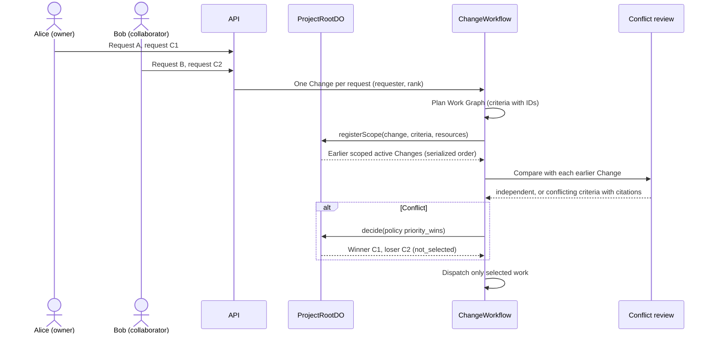

# Phase 17a plan: shared Projects and simultaneous requests

Status: active. This plan narrows `phase-17-teams.md` to one tested workflow. It came from a design
debate between Claude (Opus), codex (GPT Sol) and agy (Gemini Flash); the debate inputs are in the
session scratchpad. `phase-17-teams.md` stays the reference for the later Teams work.

## 1. Workflow to pass on prod

1. Alice owns Project P, a live app.
2. Alice shares P with Bob by email. Bob has a different email domain and his own account.
3. Within one minute, Alice asks for feature A and feature C1. Bob asks for feature B and feature C2.
   C1 and C2 contradict (for example "newest first" and "oldest first").
4. A and B ship without a manual merge.
5. C1 ships. C2 does not ship. Both users see "Not selected: conflicts with Alice's request (owner
   priority)", with a link to C1.
6. Alice can override: "Use this instead" on C2. Then C2 ships and C1 shows "Replaced by owner".
7. Bob cannot approve, promote, roll back, archive, share, edit code, or raise budgets.

## 2. Decisions

| ID | Decision | Reason |
|---|---|---|
| S-01 | Share per Project with `project_members`. Do not use Clerk Organizations. | No paid Clerk feature and no org conversion. Bob never sees Alice's other Projects. |
| S-02 | An invitation binds only to a Clerk-verified email of the signed-in user. The grant binds to the immutable user ID. | A typed email is not proof of identity. |
| S-03 | Roles: `owner` (rank 0) and `collaborator` (rank 10). One owner per Project. Clients never send role or rank. | Owner override is the requirement. Reordering collaborators can come later. |
| S-04 | Project access is not action permission. Collaborators can view and create Changes, and cancel their own Changes. All other actions are owner-only. | Today every action checks only `canAccessProject`. |
| S-05 | One Change per request. Store `requested_by` and `requester_rank` on the Change at creation. | Attribution, budget and history stay per request. A later rank change does not rewrite history. |
| S-06 | After planning, each Change registers its scope with ProjectRootDO. Root returns the earlier scoped active Changes. The later Change compares itself with each of them. | Root serializes registration, so each pair is compared exactly once. Plan-time reads alone race. |
| S-07 | A Change that registers while an earlier Change has no scope yet waits for it (bounded: 10 checks, 15 s apart). After that, the unscoped Change is treated as overlapping. | Unknown scope never counts as independent. |
| S-08 | Comparison: a deterministic pass first (shared resource tokens or routes in criteria). Pairs that overlap get one Sonnet review of the criteria. The review returns `independent`, `compatible` or `conflicting` and cites criterion IDs. Application code validates every citation. An invalid citation or an abstention counts as `conflicting` and goes to the owner. | AGENTS.md 32.3 and 34.4.2. A cheap model never confirms a conflict alone. |
| S-09 | Policy `priority_wins` (default): the lower rank number wins. The same requester: the later request wins (it supersedes the earlier one). Different requesters with the same rank: the Change waits for the owner (`awaiting_owner`). | Owner priority is the requirement. Evidence still gates every release. |
| S-10 | A losing Change that has not dispatched work and has other criteria is re-planned without the losing criteria (partial selection). In every other case the loser becomes `not_selected`. If it already runs, its work is cancelled. | Keep B when one request asks for B and C2. |
| S-11 | `recomposeDecision` refuses a `not_selected`, `cancelled` or overridden Change. | Otherwise stale recompose ships the loser over the winner. |
| S-12 | Override (owner only) creates a new linked Change with the loser's goal, requester and `supersedes_change_id`. The decision record names the owner. If the old winner has not promoted, it is cancelled with "Replaced by owner". The conflict check does not re-open a pair that has an owner override. | Workflow instance IDs cannot restart. History stays immutable. |
| S-13 | The UI shows a Requests panel with requester, outcome and reason, a Share dialog, invitations for the signed-in user, and a conflict decision card. | The users must see which requests were selected and implemented. |

## 3. Known limitation

The conflict review can miss a contradiction when the two requests use unrelated words and touch
unrelated resources. Then both Changes ship in sequence, and the later one wins. The tests of the
earlier Change usually fail on the later tree and stop it, but an agent can edit those tests. Protected
obligation tests outside agent-editable source are later work (agy's "promoted criteria become
invariants" proposal). Report such a miss as an incident. Never mark both requests as satisfied
without evidence.

## 4. Data

Migration `0022_shared_projects.sql`:

- `project_members(project_id, user_id, role, rank, added_by, created_at)`, primary key
  `(project_id, user_id)`.
- `project_invitations(id, project_id, email, role, rank, invited_by, status, accepted_user_id,
  created_at, expires_at, accepted_at)`. Status: `pending`, `accepted`, `revoked`. Expiry: 7 days.
- `changes`: add `requester_rank`, `scope_registered_at`, `outcome`, `outcome_reason`,
  `outcome_winner_change_id`, `outcome_decided_by`, `supersedes_change_id`. `created_by` is the
  requester.
- `request_conflicts(id, project_id, change_a, change_b, verdict, criteria_json, review_json,
  policy, winner_change_id, loser_change_id, decided_by, decided_at, created_at)`. Unique on the
  sorted pair.
- `users`: `email` and `display_name` are filled from Clerk when an invitation is created or accepted.
- Backfill: one `owner` row in `project_members` for each existing Project (the org owner).

`ChangeStatus` gains `not_selected` (terminal) and `awaiting_owner`.

## 5. API contract

| Route | Who | Result |
|---|---|---|
| `POST /v1/projects/:projectId/invitations` `{ email }` | owner | The invitation. Email normalized to lowercase. |
| `DELETE /v1/projects/:projectId/invitations/:invitationId` | owner | Revoked. |
| `GET /v1/projects/:projectId/members` | members | `{ members: [{ userId, name, email, role, rank, isYou }], invitations: [...] }`. Invitations are visible to the owner only. |
| `DELETE /v1/projects/:projectId/members/:userId` | owner | Access removed. The owner row cannot be removed. |
| `GET /v1/invitations` | signed in | Pending invitations for the caller's verified emails, with Project name and inviter. |
| `POST /v1/invitations/:invitationId/accept` | invitee | Membership created. Idempotent. |
| `GET /v1/projects/:projectId` | members | Adds `role` (`owner` or `collaborator`). |
| `GET /v1/projects/:projectId/changes` and `GET /v1/changes/:changeId` | members | Add `requester: { userId, name, rank, isYou }`, `outcome: { kind, reason, winnerChangeId, decidedBy, policy } | null` and `supersedesChangeId`. |
| `GET /v1/changes/:changeId/request-conflicts` | members | Cross-request conflicts of this Change, with both goals and the cited criteria. (`/conflicts` already lists conflicts inside one Change.) |
| `POST /v1/changes/:changeId/override` | owner | `{ changeId }` of the new linked Change. Only for `not_selected` or `awaiting_owner` Changes. |

Owner-only actions also include approve, promote, rollback, archive and delete, code edits, budget
raises, and cancelling another user's Change. Collaborators get `403` with a plain reason.

## 6. Work breakdown

| # | Task | Owner | Model |
|---|---|---|---|
| 1 | Migration 0022, protocol statuses and types, this plan | Claude | opus |
| 2 | Membership access in all API routes, owner-only action guard, attribution, requester-scoped idempotency | Claude | sonnet |
| 3 | Invitations and members API with verified email binding | Claude | sonnet |
| 4 | ProjectRootDO `registerScope` and serialized ordering | codex | sonnet |
| 5 | ChangeWorkflow scope step: wait, compare, Sonnet review with citation validation, decision receipts | codex | sonnet |
| 6 | `priority_wins` selection, partial re-plan, cancel a running loser, `not_selected` and `awaiting_owner` | codex | sonnet |
| 7 | Recompose guard and override command | codex | sonnet |
| 8 | Share dialog, invitations list, Requests panel, conflict card, override button | agy | sonnet |
| 9 | Critical tests: simultaneous registration, priority, same-rank, partial selection, recompose guard, RBAC | all | sonnet |
| 10 | Terraform deploy to prod, then a live two-account run with cleanup | Claude | sonnet |

## 7. Cost

- Conflict review: one Sonnet call per overlapping pair, at most 4 pairs per Change, about $0.01 each.
- The live run: 4 Changes at a $1 budget each, inside the $25 cap.
- No new Cloudflare resources. D1 rows only.
