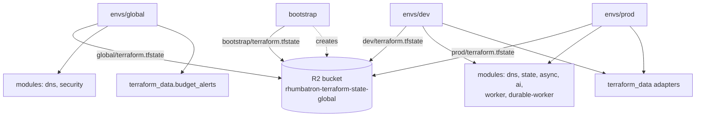
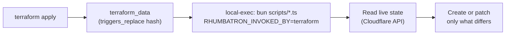

# Terraform

Terraform owns every Cloudflare control-plane resource. Do not change remote infrastructure with
the dashboard, `wrangler deploy`, or direct API writes. Read every plan. Never use
`-auto-approve`: `bun run tf` refuses it.

## Layout

| Path | State key | Purpose |
|---|---|---|
| `bootstrap/` | `bootstrap/terraform.tfstate` | R2 state bucket `rhumbatron-terraform-state-global` only. The first apply used local state (see Bootstrap). |
| `envs/global/` | `global/terraform.tfstate` | Zone-wide and account-wide singletons: `rhumbatron.com` zone settings (TLS, `ssl = "strict"`) and the billing budget alerts adapter (ADR 0019). Dev and prod never own these. |
| `envs/dev/` | `dev/terraform.tfstate` | Dev environment. Applied. |
| `envs/prod/` | `prod/terraform.tfstate` | Prod environment. Mirrors dev resource for resource (ADR 0017). Applied. Switches: `paused`, `bootstrap`, `attach_apex`. |
| `modules/` | - | Shared modules. See Modules. |

All four roots use the S3 backend on R2, with `use_lockfile = true`.



## Modules

| Module | Status | Owns |
|---|---|---|
| `worker` | Implemented | One Worker: version per bundle hash, 100 percent deployment, custom domains, cron triggers. |
| `durable-worker` | Implemented | One Worker that hosts Durable Object classes, as a full script upload (ADR 0005). |
| `dns` | Implemented | Reads the `rhumbatron.com` zone. Outputs `zone_id` and `zone_name`. Manages no records. |
| `state` | Implemented | D1 `rhumbatron-control-<env>`, R2 `rhumbatron-evidence-<env>` with lifecycle rules, KV `rhumbatron-config-<env>`. |
| `async` | Implemented | Six Queues `rhumbatron-<purpose>-<env>`. |
| `ai` | Implemented | AI Gateway `rhumbatron-models-<env>` with the Anthropic spend limit (ADR 0021). |
| `security` | Implemented | Zone settings only. WAF, rate limits, Access, and Turnstile come after the protected endpoint exists. |
| `code-storage` | Placeholder | No resources. |
| `observability` | Placeholder | No resources. Log settings are in `worker` and `durable-worker`. |

Each env root keeps some resources inline: queue consumers, Workflows, the release target Worker
`rhumbatron-acme-shop-<env>`, Clerk DNS records (prod), and the adapters below.

## Environments

| | local | dev | prod |
|---|---|---|---|
| Runs on | Miniflare via `bun run dev` | Cloudflare | Cloudflare |
| Resources | Simulated by Wrangler, stored in `.wrangler/state` | Terraform `envs/dev` | Terraform `envs/prod` |
| Name suffix | none | `-dev` | `-prod` |
| Web hostname | `localhost:5173` | `dev.rhumbatron.com` | `rhumbatron.com` |
| API hostname | `localhost:8787` | `api-dev.rhumbatron.com` | `api.rhumbatron.com` |
| R2 `events/` retention | none | 30 days | 365 days |
| R2 `evidence/` retention | none | 30 days | kept |
| R2 `tmp/` retention | none | 7 days | 7 days |
| Clerk instance | development | development | production (ADR 0017) |
| `MODEL_PROVIDER` | - | `anthropic` | `anthropic` |
| Anthropic budget per calendar month | - | $15 | $10 |
| `ALLOW_OPUS` | - | `false` | `false` |
| `www` | none | none | Custom domain of the prod web Worker; the Worker returns 301 to the apex |

Hostnames stay one label deep so Universal SSL covers them.

## Binding names

Every Worker uses the same binding names in `wrangler.jsonc` (local) and Terraform (dev, prod).

| Binding | Resource | Name pattern |
|---|---|---|
| `DB` | D1 | `rhumbatron-control-<env>` |
| `EVIDENCE` | R2 | `rhumbatron-evidence-<env>` |
| `CONFIG` | KV | `rhumbatron-config-<env>` (created; no Worker binds it yet) |
| `MEMORY` | Vectorize (temporary adapter, ADR 0003) | `rhumbatron-memory-<env>` |
| `EVENTS_00` .. `EVENTS_07` | K2 producers (coordinator) | `rhumbatron_events_NN_<env>` |
| `ARTIFACTS` | Artifacts namespace (created on first use, ADR 0010) | `rhumbatron-projects-<env>` |
| `SANDBOX` | Sandbox class in the Sandbox Worker (ADR 0012) | `rhumbatron-sandbox-<env>` |
| `METRICS` | Analytics Engine dataset | `rhumbatron_metrics_<env>` |
| Queue producers | Queues | `rhumbatron-<purpose>-<env>` for agent-wakeups, integration, verification, indexing, release, dead-letter |

R2 lifecycle rules are prefix-based. Write expiring objects under `events/`, `evidence/`, or
`tmp/`.

## Wrapper and credentials

`bun run tf <bootstrap|global|dev|prod> <terraform args...>` (`scripts/tf.ts`) loads credentials
from the macOS Keychain (ADR 0004) and runs Terraform in that root. A value that is already set
in the environment wins. The wrapper refuses `-auto-approve`.

| Variable | Keychain item | Roots |
|---|---|---|
| `CLOUDFLARE_API_TOKEN` | `rhumbatron-cloudflare-api-token` | all |
| `TF_VAR_account_id` | `rhumbatron-cloudflare-account-id` | all |
| `AWS_ACCESS_KEY_ID` / `AWS_SECRET_ACCESS_KEY` | `rhumbatron-r2-state-access-key-id` / `rhumbatron-r2-state-secret-access-key` (bucket-scoped R2 key) | all |
| `TF_VAR_alert_email` | `rhumbatron-alert-email` | global |
| `TF_VAR_clerk_secret_key` | `rhumbatron-clerk-secret-key-dev` / `-prod` | dev / prod |
| `TF_VAR_clerk_publishable_key` | `rhumbatron-clerk-publishable-key-prod` | prod |
| `TF_VAR_k2_consumer_token` | `rhumbatron-k2-consumer-token-dev` | dev, prod |
| `TF_VAR_anthropic_api_key` | `rhumbatron-anthropic-api-key` | dev, prod |
| `TF_VAR_anthropic_workspace_id` | `rhumbatron-anthropic-workspace-id` (not secret) | dev, prod |
| `TF_VAR_builds_api_token` | `rhumbatron-cloudflare-builds-token` | dev, prod |

Prod reuses the dev K2 and Builds items (ADR 0017) and the Anthropic items (ADR 0021). See ADR 0004 for token
scopes.

## Backend configuration

Each root reads the bucket and the R2 endpoint from `backend.hcl`. Git ignores it. Copy it from
`backend.example.hcl` once per root and fill in the account ID:

```hcl
bucket    = "rhumbatron-terraform-state-global"
endpoints = { s3 = "https://<ACCOUNT_ID>.r2.cloudflarestorage.com" }
```

The state key and the other backend settings are in each root's `versions.tf`.

## Environment workflow

```sh
cp infrastructure/terraform/envs/dev/backend.example.hcl infrastructure/terraform/envs/dev/backend.hcl  # once
bun run tf dev init -backend-config=backend.hcl   # once
bun run cf:bundle                                  # before every plan (writes dist/bundles/manifest.json)
bun run tf:plan:dev                                # writes dev.tfplan; read it
bun run tf:apply:dev                               # applies exactly that plan
bun run tf:drift                                   # global and dev must report no changes
```

Prod uses the same flow: `bun run tf:plan:prod`, `bun run tf:apply:prod`, `bun run tf:drift:prod`.
`tf:drift` does not cover prod. For global, run `bun run tf global plan -out=global.tfplan`, then
`bun run tf global apply global.tfplan`.

Apply order for a fresh account: `bootstrap`, `envs/global`, `envs/dev`, `envs/prod`. A fresh
environment applies twice: first with `local.bootstrap = true` (breaks the coordinator and event
router binding cycle and creates the first Durable Object migrations), then with `false`
(ADR 0012, ADR 0017).

## Temporary adapters

Provider 5.27 has no first-party resource for these items. Each adapter follows AGENTS.md section
11.4: a `terraform_data` resource runs a script from `scripts/`. Each script refuses to run unless
`RHUMBATRON_INVOKED_BY=terraform`, reads before it writes, and is safe to run again. Never call
these scripts or the API directly.

| Adapter | Resource | Script | Roots | ADR |
|---|---|---|---|---|
| K2 streams and subscriptions | `terraform_data.k2_streams`, `data.external.k2_streams` | `k2-sync.ts`, `k2-read.ts` | dev, prod | 0006 |
| K2 account limit check (plan time) | `data.external.k2_inventory` | `k2-read.ts` (`mode = inventory`) | prod | 0017 |
| Vectorize index | `terraform_data.vectorize_index`, `terraform_data.vectorize_index_teardown` | `vectorize-sync.ts` | dev, prod | 0003 |
| Sandbox Worker and container application | `terraform_data.sandbox_worker`, `terraform_data.sandbox_worker_teardown` | `sandbox-deploy.ts` | dev, prod | 0012 |
| D1 schema migrations | `terraform_data.d1_migrations` | `d1-migrate.ts` | dev, prod | AGENTS.md 11.6 |
| Billing budget alerts | `terraform_data.budget_alerts` | `budget-alerts.ts` (operator `cf` CLI login) | global | 0019 |

K2 never deletes streams. Vectorize and the Sandbox Worker delete only on a real destroy, through
their teardown resources. Artifacts has no adapter: the namespace is created on first use through
the `ARTIFACTS` binding (ADR 0010). The Workers Builds connection has no API path yet (ADR 0014,
ADR 0018).



## D1 migrations

`terraform_data.d1_migrations` in the dev and prod roots runs `scripts/d1-migrate.ts` when any
file in `migrations/d1` changes. See [`migrations/d1/README.md`](../../migrations/d1/README.md).

## Static checks

`bun run tf:check` runs `terraform fmt -check`, `terraform init -backend=false`,
`terraform validate`, and `tflint` for the bootstrap, global, dev, and prod roots. It also
validates `modules/worker` and `modules/durable-worker` directly. It does not contact the state
backend and does not create resources.

## Bootstrap (done once)

The bootstrap state is already in R2. These are the steps that created it. The Terraform token and
the backend key were created with the `cf` CLI (ADR 0004).

1. Apply `bootstrap/` with local state. It creates only the state bucket (`prevent_destroy`).
2. Create the bucket-scoped backend key with the `cf` CLI and store it in the Keychain.
3. Add the `s3` backend block with key `bootstrap/terraform.tfstate` to `bootstrap/versions.tf`.
4. `bun run tf bootstrap init -migrate-state -backend-config=backend.hcl`.
5. Confirm the state object exists in R2. Then delete the local `terraform.tfstate*` files.

## References

- Naming: [`docs/operations/naming.md`](../../docs/operations/naming.md). Pattern:
  `rhumbatron-<component>-<env>`.
- Credentials and token scopes: [ADR 0004](../../docs/adr/0004-resource-organization-and-bootstrap-credentials.md).
- Durable Object Workers: [ADR 0005](../../docs/adr/0005-durable-object-worker-deploys.md).
- Prod environment: [ADR 0017](../../docs/adr/0017-prod-environment.md).
- Runaway-billing guards: [ADR 0019](../../docs/adr/0019-runaway-billing-guards.md).
