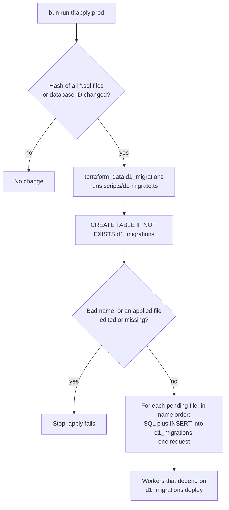

# D1 migrations

This directory holds the SQL migrations for the control database (`rhumbatron-control-<env>`). The files run in name order
from `0001_init.sql`. The newest file is `0033_first_come_choices.sql`. The sequence can skip a number.

- Name files `NNNN_description.sql` (lowercase letters, digits, and underscores). The runner
  rejects other names.
- Never edit an applied migration. The runner stores the SHA-256 of each file. It stops if an applied
  file changes or is missing. Add a new migration instead.
- Remote: `terraform apply` in `envs/prod` runs `scripts/d1-migrate.ts` through
  `terraform_data.d1_migrations` when a file in this directory changes. The
  script refuses to run unless `RHUMBATRON_INVOKED_BY=terraform`.
- The API, integration, agents, and apps Workers depend on this resource. New code therefore deploys after its tables
  exist.
- Bookkeeping table: `d1_migrations` (Wrangler-compatible, plus a `sha256` column).
- Each migration and its bookkeeping row run in one D1 query request.
- Local: `bunx wrangler d1 migrations apply DB --local` from a Worker that binds `DB` (its
  `wrangler.jsonc` sets `migrations_dir` to this directory).

